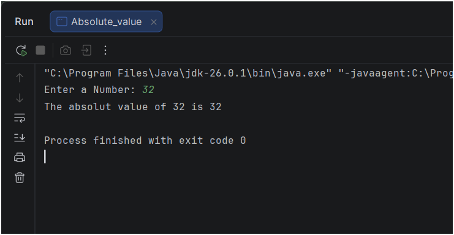
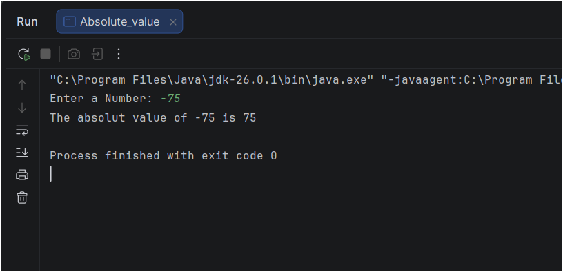

## Java Practice Question – Absolute Value Calculator

This folder contains a Java program that solves a **basic practice question** demonstrating the use of control statements (`if-else`) to calculate the absolute value of a number.

It is intended for beginners to strengthen their understanding of **core Java fundamentals**—specifically conditional logic and user input handling—through simple problem-solving.

---

## 📌 Program Overview

The program in this folder covers the following practice concepts:

- Reading user input from the console using the `Scanner` class.
- Using `if-else` conditional statements to control the flow of the program.
- Applying basic mathematical logic to convert a negative integer into a positive one (absolute value).

The program prompts the user for a number, evaluates it, and displays its absolute value clearly in the console.

---

## 🧪 Code Functionality

The program demonstrates:

### User Input
- **`Scanner sc = new Scanner(System.in);`**: Initializes the Scanner object to capture input from the standard input stream (keyboard).
- **`sc.nextInt();`**: Reads the integer value typed by the user.

### Control Flow (`if-else`)
- **`if (n >= 0)`**: Checks if the entered number is zero or positive. If true, the absolute value is exactly the same as the entered number.
- **`else`**: If the number is negative, the code block multiplies the number by `-1` (e.g., `n * (-1)`) to remove the negative sign, effectively yielding the absolute value. 

The program is written in a **simple and readable format**, with a clear package structure (`Control_Statement.Absolut_value`).

---

## 🖥️ Output

The program evaluates the condition and prints the absolute value directly to the console during execution.  
The complete console output for this practice question (testing both positive and negative inputs) is shown below.

---

## 📂 File Information

- `Absolute_value.java` — Contains the practice question program  
- `Output_1.png` — Screenshot of console output (Positive/Zero test)  
- `Output_2.png` — Screenshot of console output (Negative test)  
- `README.md` — Folder documentation  

---
## 👨‍💻 Author

**MD Shahnawaz Noor**     
*Aspiring Data Scientist* 
   
GitHub: [https://github.com/shahnawaznoor2020-code](https://github.com/shahnawaznoor2020-code)             
Email: shahnawaznoor2020@gmaIl.com  
 
---

## ⭐ Note

These practice programs help build a strong foundation in Java.  
Mastering basic control statements like `if-else` is essential before moving on to loops, methods, and object-oriented programming (OOP).