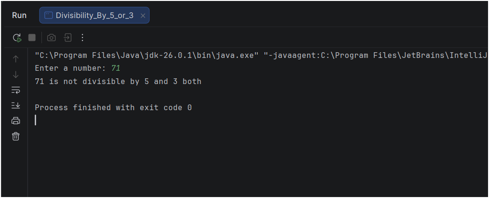
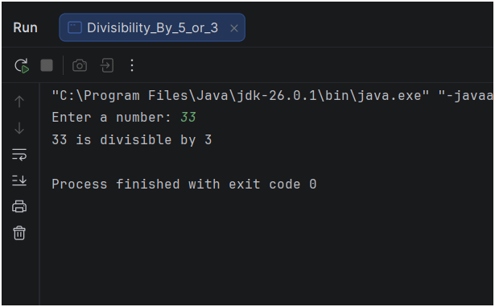
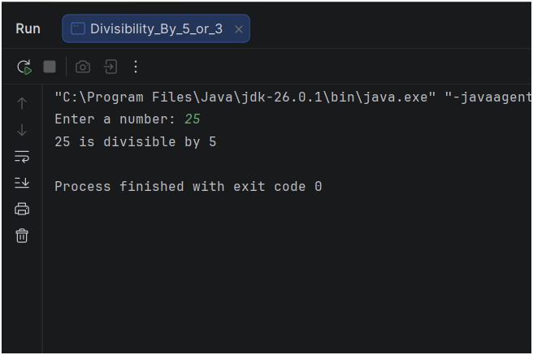

## Java Practice Question – Divisibility Checker (Multiple Conditions)

This folder contains a Java program that solves a **basic practice question** demonstrating the use of `if-else if-else` statements and the logical AND (`&&`) operator to check multiple divisibility conditions.

It is intended for beginners to strengthen their understanding of **core Java fundamentals** through simple problem-solving.

---

## 📌 Program Overview

The program in this folder covers the following practice concepts:

- Setting up a basic Java class and `main` method structure.
- Using the `Scanner` class to read integer input from the user.
- Utilizing the modulo operator (`%`) to determine divisibility.
- Implementing an `if-else if-else` ladder to handle mutually exclusive conditions.
- Using the logical AND operator (`&&`) to execute a block of code only if *both* conditions are true.

The program evaluates the divisibility of the user's input by 3, 5, or both, and displays the appropriate result clearly in the console.

---

## 🧪 Code Functionality

The program demonstrates:

### Multi-Condition Logic
- **`if (n % 5 == 0 && n % 3 == 0)`**: The most specific condition is checked first. It uses the `&&` operator to ensure the number is divisible by *both* 5 and 3 (e.g., 15). 
- **`else if (n % 3 == 0)`**: If the first condition is false, it checks if the number is divisible by just 3.
- **`else if (n % 5 == 0)`**: If the previous conditions are false, it checks if the number is divisible by just 5.
- **`else`**: The fallback block executes if the number is not divisible by either 3 or 5.

### User Interaction
- Prompts the user with `System.out.print("Enter a number: ");`
- Reads the input using `sc.nextInt();`.

The program is written in a **simple and readable format**.

---

## 🖥️ Output

The program evaluates the conditional statements and prints the final divisibility status directly to the console during execution.  
The complete console output for this practice question (testing various scenarios) is shown below.

---

## 📂 File Information

- `Divisibility_By_5_or_3.java` — Contains the practice question program  
- `Output_1.png` — Screenshot of console output (Test Case 1)
- `Output_2.png` — Screenshot of console output (Test Case 2)
- `Output_3.png` — Screenshot of console output (Test Case 3)
- `README.md` — Folder documentation  

---
## 👨‍💻 Author

**MD Shahnawaz Noor**     
*Aspiring Data Scientist* 
   
GitHub: [https://github.com/shahnawaznoor2020-code](https://github.com/shahnawaznoor2020-code)             
Email: shahnawaznoor2020@gmaIl.com  
 
---

## ⭐ Note

These practice programs help build a strong foundation in Java.  
Understanding the correct order of conditions in an `if-else if` ladder is essential before moving to switch statements and loops.