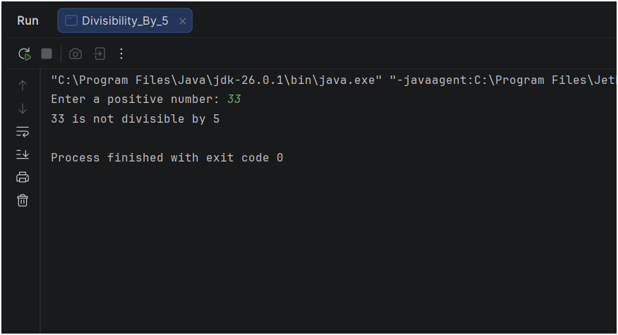

## Java Practice Question – Divisibility Checker (Single Condition)

This folder contains a Java program that solves a **basic practice question** demonstrating the use of conditional statements to check if a number is divisible by a single specific value (in this case, 5).

It is intended for beginners to strengthen their understanding of **core Java fundamentals** through simple problem-solving.

---

## 📌 Program Overview

The program in this folder covers the following practice concepts:

- Setting up a basic Java class and `main` method structure.
- Using the `Scanner` class to read integer input from the user.
- Utilizing the modulo operator (`%`) to determine if a number is completely divisible by 5 (i.e., the remainder is 0).
- Implementing simple `if-else` conditional logic to output the result.

The program evaluates the divisibility of the user's input and displays the result clearly in the console.

---

## 🧪 Code Functionality

The program demonstrates:

### Divisibility Logic
- **`n % 5 == 0`**: The core condition. The modulo operator `%` calculates the remainder of division. If `n` divided by 5 yields a remainder of exactly 0, the number is evenly divisible by 5.

### User Interaction
- Prompts the user with `System.out.print("Enter a positive number: ");`
- Reads the input using `sc.nextInt();`.

The program is written in a **simple and readable format**.

---

## 🖥️ Output

The program evaluates the conditional statement and prints the final divisibility status directly to the console during execution.  
The complete console output for this practice question is shown below.

---

## 📂 File Information

- `Divisibility_By_5.java` — Contains the practice question program  
- `Output.png` — Screenshot of console output  
- `README.md` — Folder documentation  

---
## 👨‍💻 Author

**MD Shahnawaz Noor**     
*Aspiring Data Scientist* 
   
GitHub: [https://github.com/shahnawaznoor2020-code](https://github.com/shahnawaznoor2020-code)             
Email: shahnawaznoor2020@gmaIl.com  
 
---

## ⭐ Note

These practice programs help build a strong foundation in Java.  
Understanding basic arithmetic operators like modulo (`%`) and conditional flow is essential before moving to loops and arrays.
