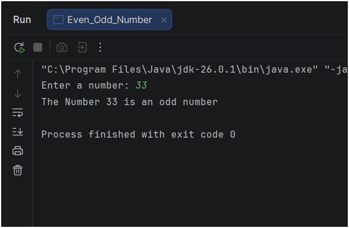
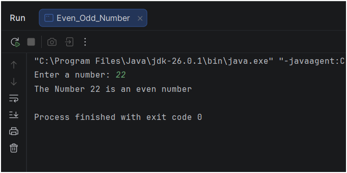

## Java Practice Question – Even or Odd Number Checker

This folder contains a Java program that solves a **basic practice question** demonstrating the use of conditional statements to determine whether a given integer is even or odd.

It is intended for beginners to strengthen their understanding of **core Java fundamentals** through simple problem-solving.

---

## 📌 Program Overview

The program in this folder covers the following practice concepts:

- Setting up a basic Java class and `main` method structure.
- Using the `Scanner` class to read integer input from the user.
- Utilizing the modulo operator (`%`) to determine the remainder of a division operation.
- Implementing simple `if-else` conditional logic to output the correct classification.

The program evaluates the user's input and displays whether the number is even or odd directly in the console.

---

## 🧪 Code Functionality

The program demonstrates:

### Even / Odd Logic
- **`n % 2 == 0`**: The core condition. The modulo operator `%` calculates the remainder of division by 2. If the remainder is exactly 0, the number is evenly divisible by 2, making it an **even** number.
- **`else` block**: If the remainder is not 0 (meaning it is 1 or -1), the number is classified as an **odd** number.

### User Interaction
- Prompts the user with `System.out.print("Enter a number: ");`
- Reads the input using `sc.nextInt();`.

The program is written in a **simple and readable format**.

---

## 🖥️ Output

The program evaluates the conditional statements and prints the final result directly to the console during execution.  
The complete console output for this practice question (testing both even and odd scenarios) is shown below.

---

## 📂 File Information

- `Even_Odd_Number.java` — Contains the practice question program  
- `Output_1.png` — Screenshot of console output (Test Case 1)  
- `Output_2.png` — Screenshot of console output (Test Case 2)  
- `README.md` — Folder documentation  

---
## 👨‍💻 Author

**MD Shahnawaz Noor**     
*Aspiring Data Scientist* 
   
GitHub: [https://github.com/shahnawaznoor2020-code](https://github.com/shahnawaznoor2020-code)             
Email: shahnawaznoor2020@gmaIl.com  
 
---

## ⭐ Note

These practice programs help build a strong foundation in Java.  
Understanding basic arithmetic operators like modulo (`%`) and standard `if-else` flows is essential before moving to complex algorithms.