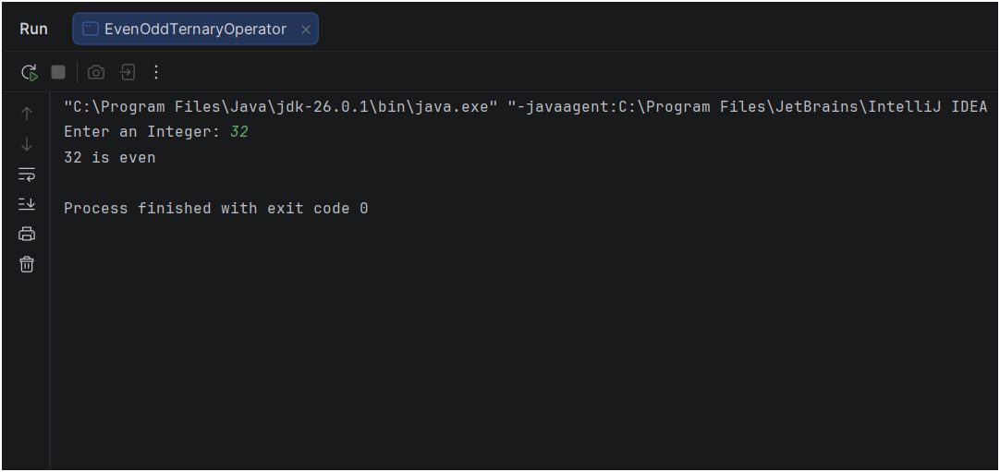

## Java Practice Question – Even or Odd Number Checker (Ternary Operator)

This folder contains a Java program that solves a **basic practice question** demonstrating the use of the ternary operator to determine whether a given integer is even or odd.

It is intended for beginners to strengthen their understanding of **core Java fundamentals**—specifically shorthand conditional statements—through simple problem-solving.

---

## 📌 Program Overview

The program in this folder covers the following practice concepts:

- Setting up a basic Java class and `main` method structure.
- Using the `Scanner` class to read integer input from the user.
- Utilizing the modulo operator (`%`) to determine the remainder of a division operation.
- Implementing the **ternary operator** (`? :`) as a concise alternative to standard `if-else` blocks for simple conditional assignments and outputs.

The program evaluates the user's input and displays whether the number is even or odd directly in the console using a single line of logic.

---

## 🧪 Code Functionality

The program demonstrates:

### The Ternary Operator Logic
- **`condition ? expression_if_true : expression_if_false`**: This is the standard syntax for the ternary operator.
- **`(a % 2 == 0) ? a + " is even" : a + " is odd"`**: 
  - The condition `(a % 2 == 0)` checks if the number is evenly divisible by 2.
  - If `true`, the expression immediately returns the string `a + " is even"`.
  - If `false`, it returns the string `a + " is odd"`.
- This evaluated string is then passed directly inside the `System.out.println()` statement, making the code much shorter than a traditional multi-line `if-else` statement.

### User Interaction
- Prompts the user with `System.out.print("Enter an Integer: ");`
- Reads the input using `sc.nextInt();`.

The program is written in a **concise and highly readable format**.

---

## 🖥️ Output

The program evaluates the ternary statement and prints the final result directly to the console during execution.  
The complete console output for this practice question is shown below.

---

## 📂 File Information

- `EvenOddTernaryOperator.java` — Contains the practice question program  
- `Output.png` — Screenshot of console output  
- `README.md` — Folder documentation  

---
## 👨‍💻 Author

**MD Shahnawaz Noor**     
*Aspiring Data Scientist* 
   
GitHub: [https://github.com/shahnawaznoor2020-code](https://github.com/shahnawaznoor2020-code)             
Email: shahnawaznoor2020@gmaIl.com  
 
---

## ⭐ Note

These practice programs help build a strong foundation in Java.  
Learning to use the ternary operator helps you write cleaner, more efficient code for simple conditional logic.