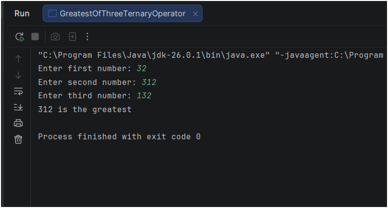

## Java Practice Question – Greatest of Three (Ternary Operator)

This folder contains a Java program that solves a **basic practice question** demonstrating how to find the greatest of three distinct numbers using a nested ternary operator.

It is intended for beginners to strengthen their understanding of **core Java fundamentals**—specifically inline conditional evaluation—through simple problem-solving.

---

## 📌 Program Overview

The program in this folder covers the following practice concepts:

- Setting up a basic Java class and `main` method structure.
- Using the `Scanner` class to read multiple integer inputs from the user.
- Replacing traditional `if-else if` statements with a compact, nested **ternary operator** (`condition ? true_value : false_value`).

The program evaluates the inputs and displays the greatest number clearly in the console.

---

## 🧪 Code Functionality

The program demonstrates:

### Nested Ternary Operator Logic
The single print statement evaluates the comparison logically:
- **` (a >= b) ? ... : ... `**: First checks if `a` is greater than or equal to `b`.
- *If true*: **`(a >= c) ? a + " is the greatest" : c + " is the greatest"`** (checks if `a` is also greater than `c`).
- *If false (meaning `b > a`)*: **`(b > c) ? b + " is the greatest" : c + " is the greatest"`** (checks if `b` is greater than `c`).

This condenses multiple lines of relational checks into one continuous expression.

### User Interaction
- Prompts the user sequentially for three numbers: `System.out.print("Enter first number: ");`, etc.
- Reads the inputs using `sc.nextInt();`.

The program is written in a **simple and readable format**.

---

## 🖥️ Output

The program evaluates the ternary expression and prints the final result directly to the console during execution.  
The complete console output for this practice question is shown below.

---

## 📂 File Information

- `GreatestOfThreeTernaryOperator.java` — Contains the practice question program  
- `Output.png` — Screenshot of console output  
- `README.md` — Folder documentation  

---
## 👨‍💻 Author

**MD Shahnawaz Noor**     
*Aspiring Data Scientist* 
   
GitHub: [https://github.com/shahnawaznoor2020-code](https://github.com/shahnawaznoor2020-code)             
Email: shahnawaznoor2020@gmaIl.com  
 
---

## ⭐ Note

These practice programs help build a strong foundation in Java.  
Understanding how to read and write nested ternary expressions is a great step toward writing concise, professional code.
