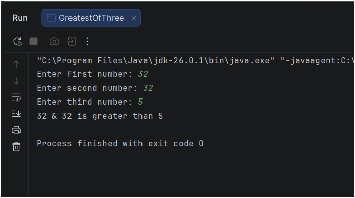
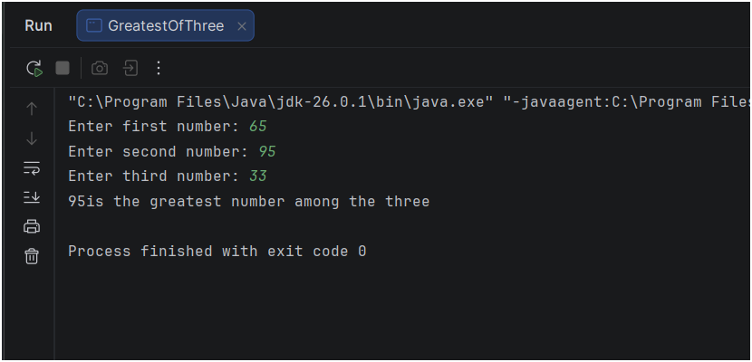

## Java Practice Question – Greatest of Three Numbers

This folder contains a Java program that solves a **basic practice question** demonstrating the use of conditional `if-else if-else` statements and logical AND (`&&`) operators to compare three distinct numbers.

It is intended for beginners to strengthen their understanding of **core Java fundamentals** through simple problem-solving.

---

## 📌 Program Overview

The program in this folder covers the following practice concepts:

- Setting up a basic Java class and `main` method structure.
- Using the `Scanner` class to read multiple integer inputs from the user.
- Implementing an extensive `if-else if-else` ladder to handle various comparison scenarios.
- Utilizing the logical AND operator (`&&`) to evaluate multiple relational conditions simultaneously (e.g., `a > b && a > c`).
- Using nested `if-else` statements to handle cases where two numbers might be equal.

The program evaluates the inputs and displays the greatest number (or notes if numbers are equal) clearly in the console.

---

## 🧪 Code Functionality

The program demonstrates:

### Relational Comparison Logic
- **Equality Checks (`a == b && b == c`)**: First checks if all numbers are identical.
- **Partial Equality (Nested `if`)**: If two numbers are equal (e.g., `a == b`), it uses a nested `if` to compare that value against the third number (`c`) to determine the greatest.
- **Strict Greater-Than Checks**: 
  - `if (a > b && a > c)`: Determines if `a` is strictly greater than both `b` and `c`.
  - `if (b > a && b > c)`: Determines if `b` is strictly greater.
  - `if (c > a && c > b)`: Determines if `c` is strictly greater.

### User Interaction
- Prompts the user sequentially for three numbers: `System.out.print("Enter first number: ");`, etc.
- Reads the inputs using `sc.nextInt();`.

The program is written in a **simple and readable format**.

---

## 🖥️ Output

The program evaluates the comparative statements and prints the final result directly to the console during execution.  
The complete console output for this practice question (testing various scenarios) is shown below.

---

## 📂 File Information

- `GreatestOfThree.java` — Contains the practice question program  
- `Output_1.png` — Screenshot of console output (Test Cases 1)  
- `Output_2.png` — Screenshot of console output (Test Cases 2)  
- `README.md` — Folder documentation  

---
## 👨‍💻 Author

**MD Shahnawaz Noor**     
*Aspiring Data Scientist* 
   
GitHub: [https://github.com/shahnawaznoor2020-code](https://github.com/shahnawaznoor2020-code)             
Email: shahnawaznoor2020@gmaIl.com  
 
---

## ⭐ Note

These practice programs help build a strong foundation in Java.  
Understanding complex conditional logic and nested statements is essential before moving to loops and object-oriented programming (OOP).
