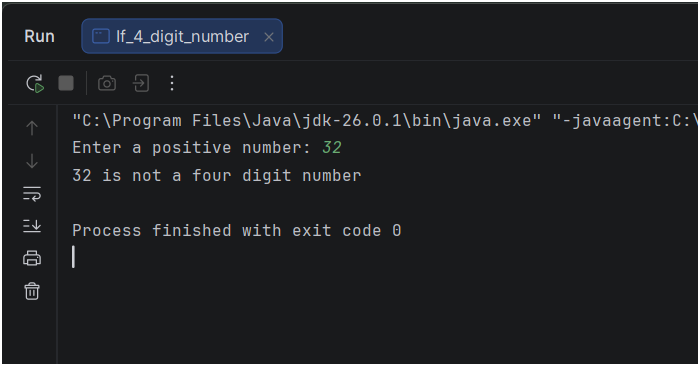

## Java Practice Question – Checking for a 4-Digit Number

This folder contains a Java program that solves a **basic practice question** demonstrating the use of conditional `if-else` statements and logical operators to determine if a number falls within a specific digit range.

It is intended for beginners to strengthen their understanding of **core Java fundamentals** through simple problem-solving.

---

## 📌 Program Overview

The program in this folder covers the following practice concepts:

- Setting up a basic Java class and `main` method structure.
- Using the `Scanner` class to read an integer input from the user.
- Utilizing the logical AND operator (`&&`) to evaluate multiple relational boundary conditions.
- Understanding the mathematical range that defines a 4-digit positive integer.

The program evaluates the user's input and displays whether or not it is a 4-digit number directly in the console.

---

## 🧪 Code Functionality

The program demonstrates:

### Range Checking Logic
- **`if (n > 999 && n < 10000)`**: The core condition. 
  - `n > 999` ensures the number is at least 1000.
  - `n < 10000` ensures the number is at most 9999.
  - Using the `&&` operator ensures both conditions must be true for the block to execute, perfectly framing the range of positive 4-digit numbers.

### User Interaction
- Prompts the user with `System.out.print("Enter a positive number: ");`
- Reads the input using `sc.nextInt();`.

The program is written in a **simple and readable format**.

---

## 🖥️ Output

The program evaluates the conditional statements and prints the final check status directly to the console during execution.  
The complete console output for this practice question is shown below.

---

## 📂 File Information

- `If_4_digit_number.java` — Contains the practice question program  
- `Output.png` — Screenshot of console output  
- `README.md` — Folder documentation  

---
## 👨‍💻 Author

**MD Shahnawaz Noor**     
*Aspiring Data Scientist* 
   
GitHub: [https://github.com/shahnawaznoor2020-code](https://github.com/shahnawaznoor2020-code)             
Email: shahnawaznoor2020@gmaIl.com  
 
---

## ⭐ Note

These practice programs help build a strong foundation in Java.  
Understanding logical boundaries and conditional flow is essential before moving to loops and object-oriented programming (OOP).
