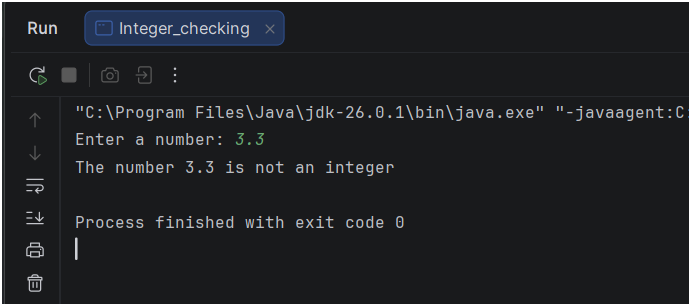

## Java Practice Question – Integer Checking

This folder contains a Java program that solves a **basic practice question** demonstrating how to check if a numeric input is a whole integer or a decimal number using type casting and mathematical differences.

It is intended for beginners to strengthen their understanding of **core Java fundamentals** through simple problem-solving.

---

## 📌 Program Overview

The program in this folder covers the following practice concepts:

- Setting up a basic Java class and `main` method structure.
- Using the `Scanner` class to read a floating-point number (`double`) from the user.
- Explicitly casting a `double` to an `int` to strip away the fractional part.
- Using `if-else` conditional logic and subtraction to determine if the original number and the cast number differ.

The program evaluates the user's input and displays whether the number is a whole integer or not directly in the console.

---

## 🧪 Code Functionality

The program demonstrates:

### Integer Verification Logic
- **`double n = sc.nextDouble();`**: Captures the user's input, preserving any decimal values.
- **`int x = (int)n;`**: Casts the input to an integer. For example, if `n` is `5.7`, `x` becomes `5`. If `n` is `5.0`, `x` becomes `5`.
- **`if (n - x > 0)`**: Compares the two variables. 
  - If the user entered a decimal (`5.7 - 5 = 0.7`), the difference is greater than 0, meaning it is *not* a whole integer.
  - If the user entered a whole number (`5.0 - 5 = 0`), the difference is exactly 0, meaning it *is* an integer.

### User Interaction
- Prompts the user with `System.out.print("Enter a number: ");`
- Reads the input using `sc.nextDouble();`.

The program is written in a **simple and readable format**.

---

## 🖥️ Output

The program evaluates the logic and prints the final classification directly to the console during execution.  
The complete console output for this practice question is shown below.

---

## 📂 File Information

- `Integer_checking.java` — Contains the practice question program  
- `Output.png` — Screenshot of console output  
- `README.md` — Folder documentation  

---
## 👨‍💻 Author

**MD Shahnawaz Noor**     
*Aspiring Data Scientist* 
   
GitHub: [https://github.com/shahnawaznoor2020-code](https://github.com/shahnawaznoor2020-code)             
Email: shahnawaznoor2020@gmaIl.com  
 
---

## ⭐ Note

These practice programs help build a strong foundation in Java.  
Understanding type casting and numerical relationships is essential before moving to loops and object-oriented programming (OOP).
