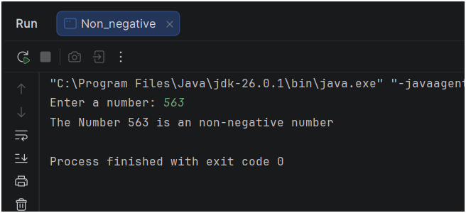

## Java Practice Question – Non-Negative Number Checker

This folder contains a Java program that solves a **basic practice question** demonstrating the use of a simple conditional `if-else` statement to determine if an input integer is non-negative.

It is intended for beginners to strengthen their understanding of **core Java fundamentals** through simple problem-solving.

---

## 📌 Program Overview

The program in this folder covers the following practice concepts:

- Setting up a basic Java class and `main` method structure.
- Using the `Scanner` class to read an integer input from the user.
- Utilizing a relational operator (`>=`) within a conditional `if` statement to evaluate the sign of a number.

The program evaluates the user's input and displays whether the number is non-negative or negative directly in the console.

---

## 🧪 Code Functionality

The program demonstrates:

### Relational Evaluation Logic
- **`if (n >= 0)`**: The core condition. In mathematics and programming, a number is considered "non-negative" if it is greater than or equal to zero (i.e., it is a positive number or zero).
- **`else`**: The fallback block executes if the condition is false (i.e., the number is strictly less than zero, meaning it is negative).

### User Interaction
- Prompts the user with `System.out.print("Enter a number: ");`
- Reads the input using `sc.nextInt();`.

The program is written in a **simple and readable format**.

---

## 🖥️ Output

The program evaluates the conditional statement and prints the final classification directly to the console during execution.  
The complete console output for this practice question is shown below.

---

## 📂 File Information

- `Non_negative.java` — Contains the practice question program  
- `Output.png` — Screenshot of console output  
- `README.md` — Folder documentation  

---
## 👨‍💻 Author

**MD Shahnawaz Noor**     
*Aspiring Data Scientist* 
   
GitHub: [https://github.com/shahnawaznoor2020-code](https://github.com/shahnawaznoor2020-code)             
Email: shahnawaznoor2020@gmaIl.com  
 
---

## ⭐ Note

These practice programs help build a strong foundation in Java.  
Understanding basic relational operators is essential before moving to complex conditional flow and loops.
