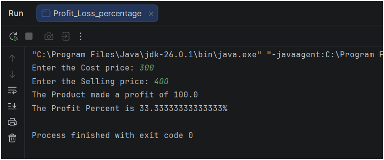
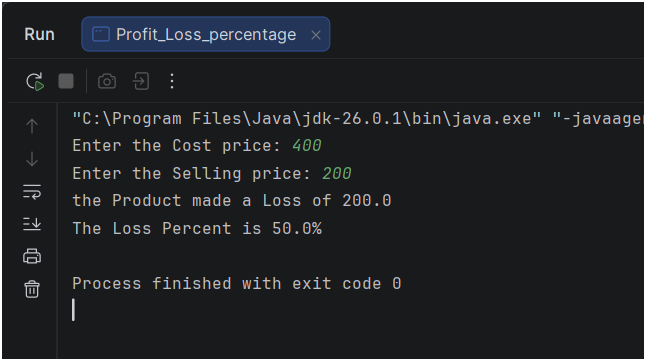

## Java Practice Question – Profit and Loss Percentage Calculator

This folder contains a Java program that solves a **basic practice question** demonstrating the use of conditional `if-else if-else` statements alongside mathematical formulas to calculate both the absolute amount and the percentage of profit or loss.

It is intended for beginners to strengthen their understanding of **core Java fundamentals** through simple problem-solving and basic arithmetic operations.

---

## 📌 Program Overview

The program in this folder covers the following practice concepts:

- Setting up a basic Java class and `main` method structure.
- Using the `Scanner` class to read numeric inputs from the user (Cost Price and Selling Price).
- Implementing `if-else if-else` conditional logic to determine whether the transaction resulted in a profit, a loss, or breaking even.
- Applying standard mathematical formulas to compute the exact percentage of the profit or loss.
- Handling data types properly (like `double` or `float`) to ensure accurate percentage calculation (including decimal points).

The program evaluates the user's inputs and displays the transaction outcome, the exact amount, and the calculated percentage directly in the console.

---

## 🧪 Code Functionality

The program demonstrates:

### Profit and Loss Percentage Logic
- **`SP > CP` (Profit)**: If the Selling Price is greater than the Cost Price, a profit is made. 
  - *Amount*: Calculated as `SP - CP`.
  - *Percentage*: Calculated using the formula `(Profit * 100) / CP`.
- **`CP > SP` (Loss)**: If the Cost Price is greater than the Selling Price, a loss is incurred. 
  - *Amount*: Calculated as `CP - SP`.
  - *Percentage*: Calculated using the formula `(Loss * 100) / CP`.
- **`SP == CP`**: Handles the break-even scenario where there is neither a profit nor a loss.

### User Interaction
- Prompts the user to enter the Cost Price and Selling Price sequentially.
- Reads the inputs using the `Scanner` object.

The program is written in a **simple and readable format**.

---

## 🖥️ Output

The program evaluates the inputs, performs the mathematical operations, and prints the final calculation directly to the console during execution.  
The complete console output for this practice question (testing various scenarios) is shown below.

---

## 📂 File Information

- `Profit_Loss_percentage.java` — Contains the practice question program  
- `Output_1.png` — Screenshot of console output (Test Case 1)  
- `Output_2.png` — Screenshot of console output (Test Case 2)
- `README.md` — Folder documentation  

---
## 👨‍💻 Author

**MD Shahnawaz Noor**     
*Aspiring Data Scientist* 
   
GitHub: [https://github.com/shahnawaznoor2020-code](https://github.com/shahnawaznoor2020-code)             
Email: shahnawaznoor2020@gmaIl.com  
 
---

## ⭐ Note

These practice programs help build a strong foundation in Java.  
Understanding how to integrate mathematical formulas with conditional flow is essential before moving to loops and object-oriented programming (OOP).