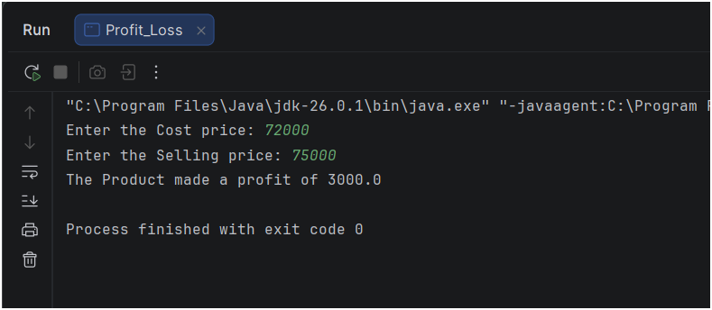
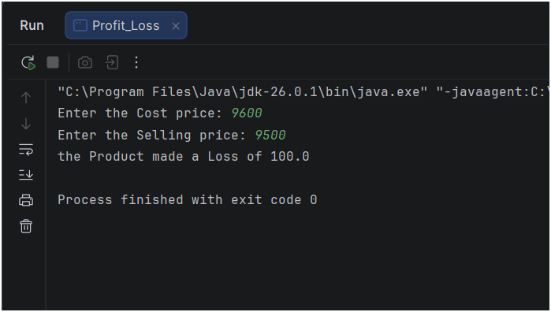

## Java Practice Question – Profit and Loss Calculator

This folder contains a Java program that solves a **basic practice question** demonstrating the use of conditional `if-else if-else` statements to calculate profit or loss from a transaction.

It is intended for beginners to strengthen their understanding of **core Java fundamentals** through simple problem-solving.

---

## 📌 Program Overview

The program in this folder covers the following practice concepts:

- Setting up a basic Java class and `main` method structure.
- Using the `Scanner` class to read numeric inputs from the user (Cost Price and Selling Price).
- Utilizing relational operators (`>`, `<`) to compare the selling price against the cost price.
- Implementing `if-else if-else` conditional logic to determine the outcome.
- Performing basic arithmetic (subtraction) to calculate the exact amount of profit or loss.

The program evaluates the user's inputs and displays the transaction outcome and the exact amount directly in the console.

---

## 🧪 Code Functionality

The program demonstrates:

### Profit and Loss Logic
- **`SP > CP`**: If the Selling Price is strictly greater than the Cost Price, a profit is made. The exact profit is calculated as `SP - CP`.
- **`CP > SP`**: If the Cost Price is strictly greater than the Selling Price, a loss is incurred. The exact loss is calculated as `CP - SP`.
- **`SP == CP`**: Handles the scenario where the selling price equals the cost price, resulting in neither a profit nor a loss.

### User Interaction
- Prompts the user to enter the Cost Price and Selling Price sequentially.
- Reads the inputs using the `Scanner` object.

The program is written in a **simple and readable format**.

---

## 🖥️ Output

The program evaluates the inputs and prints the final calculation directly to the console during execution.  
The complete console output for this practice question (testing various scenarios) is shown below.

---

## 📂 File Information

- `Profit_Loss.java` — Contains the practice question program  
- `Output_1.png` — Screenshot of console output (Test Case 1)  
- `Output_2.png` — Screenshot of console output (Test Case 2)
- `README.md` — Folder documentation  

---
## 👨‍💻 Author

**MD Shahnawaz Noor**     
*Aspiring Data Scientist* 
   
GitHub: [https://github.com/shahnawaznoor2020-code](https://github.com/shahnawaznoor2020-code)             
Email: shahnawaznoor2020@gmaIl.com  
 
---

## ⭐ Note

These practice programs help build a strong foundation in Java.  
Understanding basic arithmetic operations paired with conditional flow is essential before moving to loops and object-oriented programming (OOP).