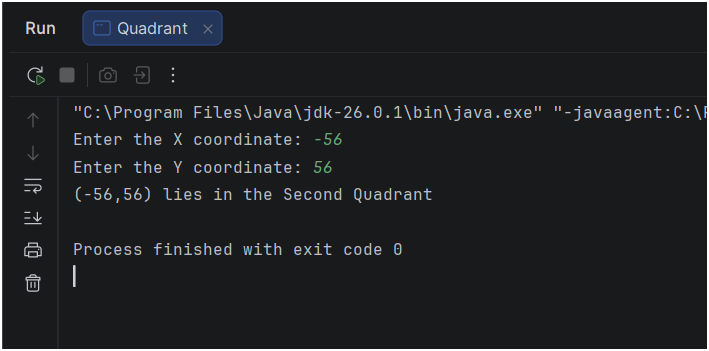

## Java Practice Question – Quadrant Finder

This folder contains a Java program that solves a **basic practice question** demonstrating the use of conditional `if-else if-else` statements and logical operators to determine the Cartesian quadrant of a given coordinate point.

It is intended for beginners to strengthen their understanding of **core Java fundamentals** through simple problem-solving.

---

## 📌 Program Overview

The program in this folder covers the following practice concepts:

- Setting up a basic Java class and `main` method structure.
- Using the `Scanner` class to read multiple integer inputs (X and Y coordinates) from the user.
- Utilizing the logical AND operator (`&&`) to evaluate multiple relational conditions simultaneously.
- Understanding Cartesian coordinate logic (positive/negative axes, origin, and axis lines).

The program evaluates the coordinates and displays their specific location (quadrant, axis, or origin) clearly in the console.

---

## 🧪 Code Functionality

The program demonstrates:

### Coordinate Evaluation Logic
- **Origin (`x == 0 && y == 0`)**: Checks if the point is at the center `(0,0)`.
- **First Quadrant (`x > 0 && y > 0`)**: Both X and Y are positive.
- **Second Quadrant (`x < 0 && y > 0`)**: X is negative, Y is positive.
- **Third Quadrant (`x < 0 && y < 0`)**: Both X and Y are negative.
- **Fourth Quadrant (`x > 0 && y < 0`)**: X is positive, Y is negative.
- **X-Axis (`x != 0 && y == 0`)**: The point lies anywhere on the horizontal axis.
- **Y-Axis (`x == 0 && y != 0`)**: The point lies anywhere on the vertical axis.

### User Interaction
- Prompts the user sequentially for the coordinates: `System.out.print("Enter X co-ordinate: ");`, etc.
- Reads the inputs using `sc.nextInt();`.

The program is written in a **simple and readable format**.

---

## 🖥️ Output

The program evaluates the coordinates and prints the location directly to the console during execution.  
The complete console output for this practice question is shown below.

---

## 📂 File Information

- `Quadrant.java` — Contains the practice question program  
- `Output.png` — Screenshot of console output  
- `README.md` — Folder documentation  

---
## 👨‍💻 Author

**MD Shahnawaz Noor**     
*Aspiring Data Scientist* 
   
GitHub: [https://github.com/shahnawaznoor2020-code](https://github.com/shahnawaznoor2020-code)             
Email: shahnawaznoor2020@gmaIl.com  
 
---

## ⭐ Note

These practice programs help build a strong foundation in Java.  
Understanding complex conditional logic and coordinate systems is essential before moving to graphics, loops, and object-oriented programming (OOP).
