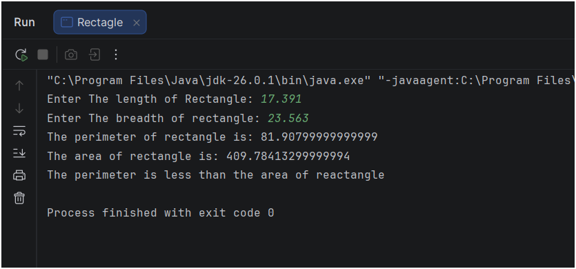

## Java Practice Question – Rectangle Logic

This folder contains a Java program that solves a **basic practice question** demonstrating the calculation and comparison of a rectangle's area and perimeter based on user-provided dimensions.

It is intended for beginners to strengthen their understanding of **core Java fundamentals**, arithmetic operations, and conditional logic through simple problem-solving.

---

## 📌 Program Overview

The program in this folder covers the following practice concepts:

- Setting up a basic Java class and `main` method structure.
- Using the `Scanner` class to read multiple inputs (length and breadth) from the user.
- Using mathematical formulas to calculate the area and perimeter of a rectangle.
- Using `if-else if-else` statements to compare two calculated numerical values.

The program calculates both metrics and displays a logical comparison (which one is greater, or if they are equal) clearly in the console.

---

## 🧪 Code Functionality

The program demonstrates:

### Rectangle Calculations
- **Area Calculation**: `int area = l * b;` (Length multiplied by Breadth).
- **Perimeter Calculation**: `int perimeter = 2 * (l + b);` (Twice the sum of Length and Breadth).

### Comparison Logic
- **`if (area > perimeter)`**: Checks if the calculated area is numerically greater than the calculated perimeter.
- **`else if (perimeter > area)`**: Checks if the perimeter is numerically greater than the area.
- **`else`**: The fallback block handles the case where the area and perimeter are exactly equal.

### User Interaction
- Prompts the user sequentially for the dimensions: `System.out.print("Enter Length of Rectagle: ");`, etc.
- Reads the inputs using `sc.nextInt();`.

The program is written in a **simple and readable format**.

---

## 🖥️ Output

The program calculates the metrics, compares them, and prints the final result directly to the console during execution.  
The complete console output for this practice question is shown below.

---

## 📂 File Information

- `Rectagle.java` — Contains the practice question program  
- `Output.png` — Screenshot of console output  
- `README.md` — Folder documentation  

---
## 👨‍💻 Author

**MD Shahnawaz Noor**     
*Aspiring Data Scientist* 
   
GitHub: [https://github.com/shahnawaznoor2020-code](https://github.com/shahnawaznoor2020-code)             
Email: shahnawaznoor2020@gmaIl.com  
 
---

## ⭐ Note

These practice programs help build a strong foundation in Java.  
Understanding basic arithmetic calculations combined with conditional flow is essential before moving to complex algorithms and loops.
