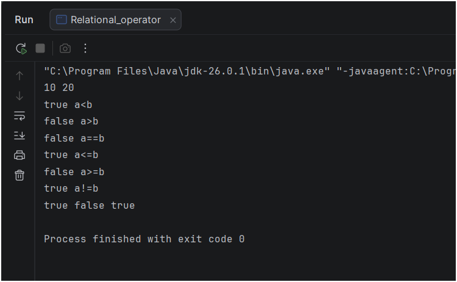

## Java Practice Question – Relational Operators

This folder contains a Java program that solves a **basic practice question** demonstrating the use of relational operators (`>`, `<`, `==`, `!=`, `>=`, `<=`) to compare two numbers.

It is intended for beginners to strengthen their understanding of **core Java fundamentals** through simple problem-solving.

---

## 📌 Program Overview

The program in this folder covers the following practice concepts:

- Setting up a basic Java class and `main` method structure.
- Using the `Scanner` class to read multiple integer inputs from the user.
- Utilizing Java's six core relational operators to evaluate the relationship between two variables.
- Outputting boolean values (`true` or `false`) based on those evaluations.

The program evaluates the numbers and displays the boolean results of all six comparisons clearly in the console.

---

## 🧪 Code Functionality

The program demonstrates:

### Relational Comparisons
The program compares two integers (`a` and `b`) and prints the boolean outcome of:
- **`a > b`**: Greater than
- **`a < b`**: Less than
- **`a == b`**: Equal to
- **`a != b`**: Not equal to
- **`a >= b`**: Greater than or equal to
- **`a <= b`**: Less than or equal to

### User Interaction
- Prompts the user for two numbers: `System.out.print("Enter first number: ");`, etc.
- Reads the inputs using `sc.nextInt();`.

The program is written in a **simple and readable format**.

---

## 🖥️ Output

The program evaluates the relational operators and prints the boolean results directly to the console during execution.  
The complete console output for this practice question is shown below.

---

## 📂 File Information

- `Relational_operator.java` — Contains the practice question program  
- `Output.png` — Screenshot of console output  
- `README.md` — Folder documentation  

---
## 👨‍💻 Author

**MD Shahnawaz Noor**     
*Aspiring Data Scientist* 
   
GitHub: [https://github.com/shahnawaznoor2020-code](https://github.com/shahnawaznoor2020-code)             
Email: shahnawaznoor2020@gmaIl.com  
 
---

## ⭐ Note

These practice programs help build a strong foundation in Java.  
Understanding relational operators and boolean outcomes is the prerequisite for all conditional statements (`if`, `while`, `for`).
