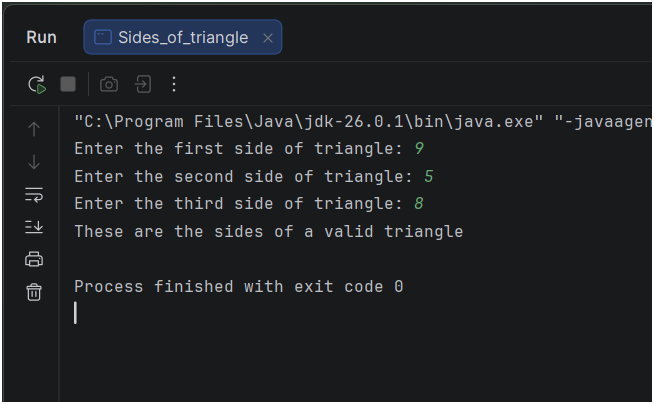

## Java Practice Question – Valid Triangle Checker

This folder contains a Java program that solves a **basic practice question** demonstrating the use of conditional `if-else` statements and logical operators to determine if three given lengths can form a valid triangle.

It is intended for beginners to strengthen their understanding of **core Java fundamentals** and mathematical logic through simple problem-solving.

---

## 📌 Program Overview

The program in this folder covers the following practice concepts:

- Setting up a basic Java class and `main` method structure.
- Using the `Scanner` class to read multiple integer inputs from the user (representing the three sides of a triangle).
- Implementing the **Triangle Inequality Theorem**, which states that the sum of the lengths of any two sides of a triangle must be greater than the length of the third side.
- Utilizing the logical AND operator (`&&`) to evaluate multiple relational conditions simultaneously.

The program evaluates the inputs and displays whether the provided sides can successfully form a triangle directly in the console.

---

## 🧪 Code Functionality

The program demonstrates:

### Triangle Inequality Logic
To form a valid triangle with sides `a`, `b`, and `c`, all three of the following conditions must be true:
- `a + b > c`
- `a + c > b`
- `b + c > a`

The program uses an `if` statement combining these checks using the logical AND (`&&`) operator. If the combined condition evaluates to `true`, it is a valid triangle; otherwise, the `else` block executes, indicating it is invalid.

### User Interaction
- Prompts the user sequentially for the lengths of the three sides.
- Reads the inputs using `sc.nextInt();`.

The program is written in a **simple and readable format**.

---

## 🖥️ Output

The program evaluates the conditional statements and prints the final validation result directly to the console during execution.  
The complete console output for this practice question is shown below.

---

## 📂 File Information

- `Sides_of_triangle.java` — Contains the practice question program  
- `Output.png` — Screenshot of console output  
- `README.md` — Folder documentation  

---
## 👨‍💻 Author

**MD Shahnawaz Noor**     
*Aspiring Data Scientist* 
   
GitHub: [https://github.com/shahnawaznoor2020-code](https://github.com/shahnawaznoor2020-code)             
Email: shahnawaznoor2020@gmaIl.com  
 
---

## ⭐ Note

These practice programs help build a strong foundation in Java.  
Understanding how to translate mathematical theorems into logical code conditions is an essential skill for software development.