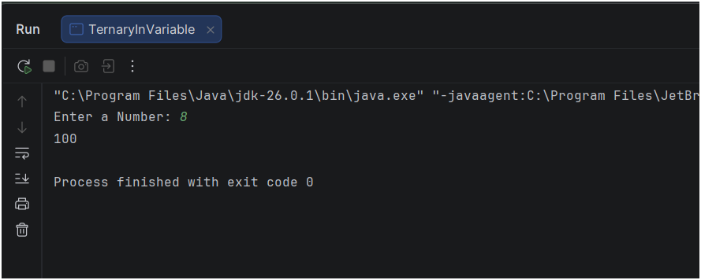
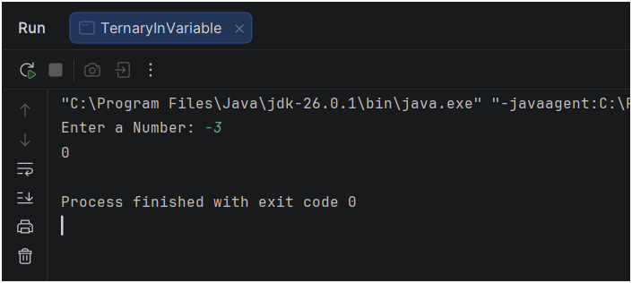

## Java Practice Question – Ternary Operator Assignment

This folder contains a Java program that solves a **basic practice question** demonstrating the use of the ternary operator to evaluate a condition and assign the result directly to a variable.

It is intended for beginners to strengthen their understanding of **core Java fundamentals**—specifically shorthand conditional assignments—through simple problem-solving.

---

## 📌 Program Overview

The program in this folder covers the following practice concepts:

- Setting up a basic Java class and `main` method structure.
- Using the `Scanner` class to read input from the user.
- Implementing the **ternary operator** (`? :`) as a concise alternative to standard `if-else` blocks.
- Assigning the evaluated result of the ternary expression to a variable for later use.

The program evaluates the user's input, stores the resulting value in a variable, and displays it clearly in the console.

---

## 🧪 Code Functionality

The program demonstrates:

### Ternary Assignment Logic
- **`variable = (condition) ? expression_if_true : expression_if_false;`**: This syntax evaluates the condition and directly assigns the matching expression's value to the variable.
- Unlike just printing the ternary result directly, storing the result in a variable allows for cleaner code and reusability of the outcome before it is printed or processed further.

### User Interaction
- Prompts the user for input.
- Reads the input using the `Scanner` object.

The program is written in a **concise and highly readable format**.

---

## 🖥️ Output

The program evaluates the ternary statement, assigns the result, and prints it directly to the console during execution.  
The complete console output for this practice question (testing different scenarios) is shown below.

---

## 📂 File Information

- `TernaryInVariable.java` — Contains the practice question program  
- `Output_1.png` — Screenshot of console output (Test Case 1)  
- `Output_2.png` — Screenshot of console output (Test Case 2)  
- `README.md` — Folder documentation  

---
## 👨‍💻 Author

**MD Shahnawaz Noor**     
*Aspiring Data Scientist* 
   
GitHub: [https://github.com/shahnawaznoor2020-code](https://github.com/shahnawaznoor2020-code)             
Email: shahnawaznoor2020@gmaIl.com  
 
---

## ⭐ Note

These practice programs help build a strong foundation in Java.  
Understanding how to assign values using the ternary operator helps you write cleaner, more efficient code for simple conditional data flows.