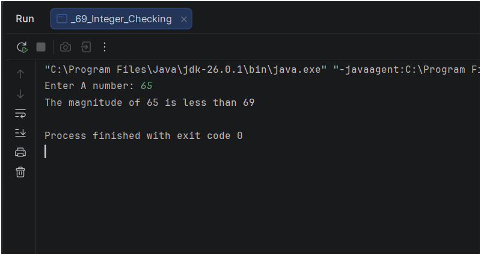
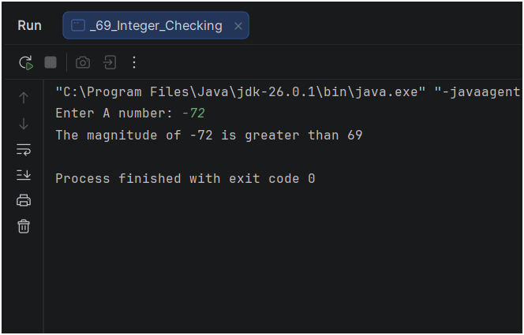

## Java Practice Question – Integer Magnitude Checking

This folder contains a Java program that solves a **basic practice question** demonstrating integer magnitude evaluation using nested logical conditions and standard control statements.

It is intended for beginners to strengthen their understanding of **core Java fundamentals** through simple problem-solving.

---

## 📌 Program Overview

The program in this folder covers the following practice concepts:

- Setting up a basic Java class and `main` method structure.
- Using the `Scanner` class to read integer input from the user.
- Implementing `if-else if-else` conditional logic to determine the magnitude of a number.
- Using logical AND operators (`&&`) alongside negation (`-n`) to evaluate both positive and negative bounds simultaneously.

The program executes the logical checks based on user input and displays the resulting comparison clearly in the console.

---

## 🧪 Code Functionality

The program demonstrates:

### Magnitude Checking Logic
- Instead of using a built-in absolute value function (`Math.abs()`), the program evaluates the magnitude manually.
- **`if (n < 69 && -n < 69)`**: Checks if the number falls strictly within the range of -68 to 68. 
- **`else if (n == 69 && -n == 69)`**: (Note: Since `n` cannot be 69 and -69 simultaneously, this specific condition will never be true in Java. The user may want to review this logic, perhaps intending `n == 69 || -n == 69`).
- **`else`**: Catches all other cases where the magnitude is greater than 69.

### User Interaction
- Prompts the user with `System.out.print("Enter A number: ");`
- Reads the input using `sc.nextInt();`.

The program is written in a **simple and readable format**.

---

## 🖥️ Output

The program evaluates the conditional statements and prints the final magnitude comparison directly to the console during execution.  
The complete console output for this practice question is shown below.

---

## 📂 File Information

- `_69_Integer_Checking.java` — Contains the practice question program  
- `Output_1.png` — Screenshot of console output (Part 1)  
- `Output_2.png` — Screenshot of console output (Part 2)  
- `README.md` — Folder documentation  

---
## 👨‍💻 Author

**MD Shahnawaz Noor**     
*Aspiring Data Scientist* 
   
GitHub: [https://github.com/shahnawaznoor2020-code](https://github.com/shahnawaznoor2020-code)             
Email: shahnawaznoor2020@gmaIl.com  
 
---

## ⭐ Note

These practice programs help build a strong foundation in Java.  
Understanding logical operators and conditional flow is essential before moving to object-oriented programming (OOP).
