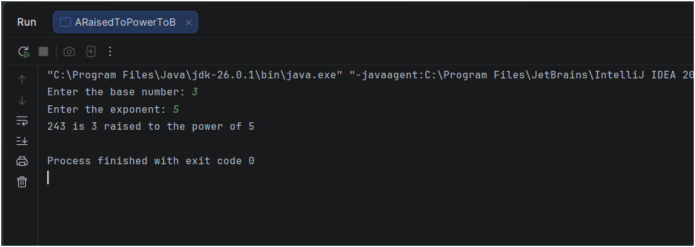

## Java Practice Question – Calculate A Raised to the Power of B

This folder contains a Java program that solves a **basic practice question** demonstrating how to calculate the value of a base number raised to the power of an exponent ($A^B$).

It is intended for beginners to strengthen their understanding of **core Java fundamentals**, specifically loop iteration and variable accumulation, often without relying on built-in math libraries.

---

## 📌 Program Overview

The program in this folder covers the following practice concepts:

- Setting up a basic Java class and `main` method structure.
- Using the `Scanner` class to read two integer inputs from the user: the base ($A$) and the exponent ($B$).
- Using a `for` or `while` loop to repeatedly multiply the base number by itself.
- Storing and updating a cumulative result variable.

The program calculates the final exponential value and prints the result clearly in the console.

---

## 🧪 Code Functionality

The program demonstrates:

### Exponential Calculation Logic
- **Initialization**: Creating a result variable (typically initialized to 1).
- **Looping**: Iterating exactly $B$ times using a loop structure.
- **Accumulation**: In each iteration, multiplying the current result by the base $A$ (e.g., `result *= A`).
- **Edge Cases**: Handling the scenario where the exponent is 0 (initializing the result variable to 1 naturally handles the rule that any non-zero number to the power of 0 is 1).

### User Interaction
- Prompts the user for the base number and the exponent.
- Reads the inputs using the `Scanner` class.

The program is written in a **simple and readable format**, breaking down a common mathematical operation into iterative programming steps.

---

## 🖥️ Output

The program executes the calculation loop and prints the final exponential result directly to the console.  
The complete console output for this practice question is shown below.

---

## 📂 File Information

- `ARaisedToPowerToB.java` — Contains the practice question program  
- `Output.png` — Screenshot of console output  
- `README.md` — Folder documentation  

---
## 👨‍💻 Author

**MD Shahnawaz Noor**     
*Aspiring Data Scientist* 
   
GitHub: [https://github.com/shahnawaznoor2020-code](https://github.com/shahnawaznoor2020-code)             
Email: shahnawaznoor2020@gmaIl.com  
 
---

## ⭐ Note

These practice programs help build a strong foundation in Java.  
Implementing mathematical operations manually using loops is an excellent way to build algorithmic thinking before moving on to utilizing built-in functions like `Math.pow()`.