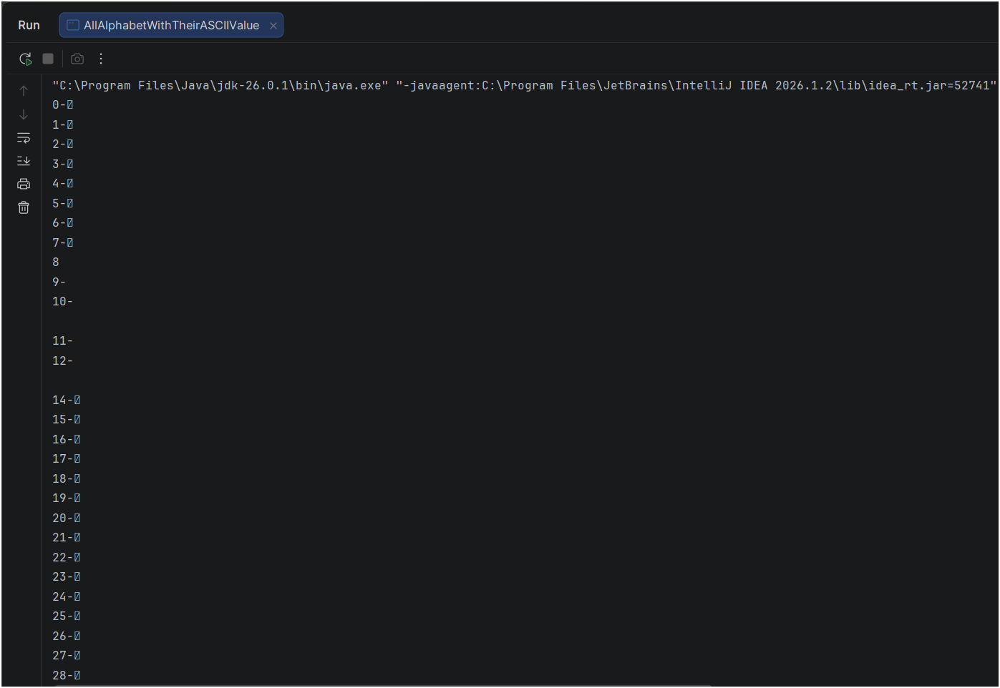
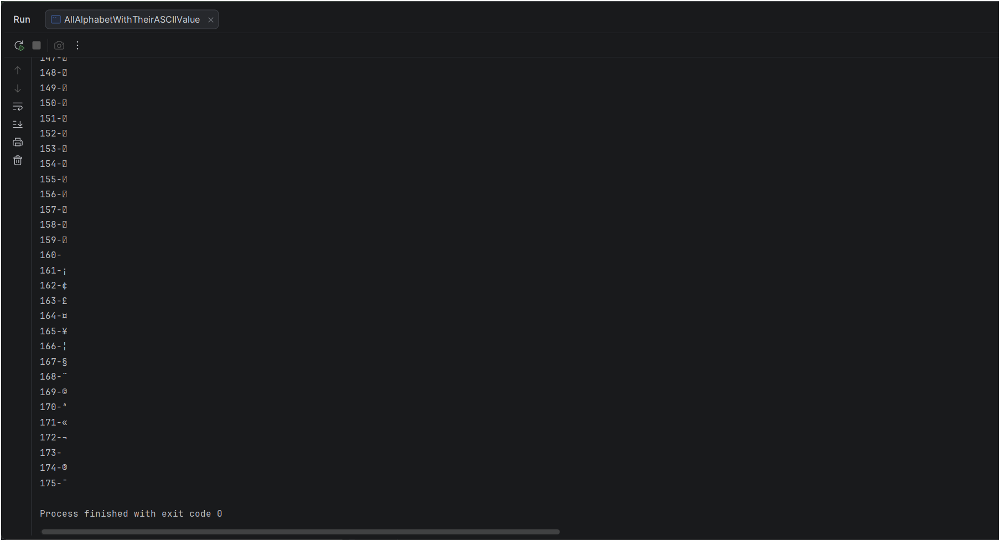

## Java Practice Question – Alphabets and Their ASCII Values

This folder contains a Java program that solves a **basic practice question** demonstrating how to iterate through characters and display their corresponding ASCII (American Standard Code for Information Interchange) numeric values.

It is intended for beginners to strengthen their understanding of **core Java fundamentals**, specifically loops, character data types, and type casting.

---

## 📌 Program Overview

The program in this folder covers the following practice concepts:

- Setting up a basic Java class and `main` method structure.
- Using a loop (such as a `while` or `for` loop) to iterate through the alphabet.
- Understanding the `char` data type and how characters are stored as integer values behind the scenes.
- Using explicit type casting `(int)` to reveal the underlying ASCII integer value of a character.

The program automatically loops through the specified alphabetical range and prints both the character and its ASCII value clearly in the console.

---

## 🧪 Code Functionality

The program demonstrates:

### Character Iteration and ASCII Casting
- **Looping Characters**: In Java, you can loop using `char` variables just like numbers (e.g., `for(char ch = 'A'; ch <= 'Z'; ch++)` or `for(char ch = 'a'; ch <= 'z'; ch++)`).
- **Getting the ASCII Value**: By casting the character to an integer—`(int) ch`—the program extracts the numeric ASCII code associated with that specific character (e.g., 'A' is 65, 'a' is 97).

The program is written in a **concise and readable format**, requiring no user input to run.

---

## 🖥️ Output

The program executes the loop and prints the character-ASCII pairs directly to the console.  
The complete console output for this practice question is shown below.

---

## 📂 File Information

- `AllAlphabetWithTheirASCIIValue.java` — Contains the practice question program  
- `Output_1.png` — Screenshot of console output (Part 1)  
- `Output_2.png` — Screenshot of console output (Part 2)  
- `README.md` — Folder documentation  

---
## 👨‍💻 Author

**MD Shahnawaz Noor**     
*Aspiring Data Scientist* 
   
GitHub: [https://github.com/shahnawaznoor2020-code](https://github.com/shahnawaznoor2020-code)             
Email: shahnawaznoor2020@gmaIl.com  
 
---

## ⭐ Note

These practice programs help build a strong foundation in Java.  
Understanding how characters map to integer values is an essential concept for text processing, cryptography, and handling character inputs.