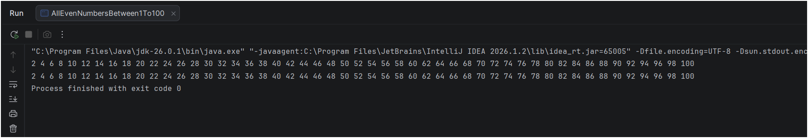

## Java Practice Question – All Even Numbers Between 1 to 100

This folder contains a Java program that solves a **basic practice question** demonstrating the use of loops and conditional statements to find and print all even numbers within a specific range (1 to 100).

It is intended for beginners to strengthen their understanding of **core Java fundamentals**, specifically loop iteration and the modulo operator.

---

## 📌 Program Overview

The program in this folder covers the following practice concepts:

- Setting up a basic Java class and `main` method structure.
- Using a loop construct (such as a `for` or `while` loop) to iterate through a sequence of numbers from 1 up to 100.
- Utilizing the modulo operator (`%`) to determine if a number is completely divisible by 2 (the definition of an even number).
- Implementing `if` conditional logic inside a loop to filter and print only the matching numbers.

The program automatically iterates through the range and prints the even numbers clearly in the console.

---

## 🧪 Code Functionality

The program demonstrates:

### Iteration and Filtering Logic
- **Looping**: Iterates a variable (e.g., `i`) starting from 1 up to and including 100.
- **`i % 2 == 0`**: Inside the loop, this condition checks if the current number `i` is an even number. If the remainder of division by 2 is exactly 0, the condition is true.
- **Output**: When the condition is met, the program prints the number. Odd numbers are simply bypassed.

The program is written in a **concise and readable format**, automatically executing without requiring user input.

---

## 🖥️ Output

The program executes the loop and prints all the calculated even numbers directly to the console.  
The complete console output for this practice question is shown below.

---

## 📂 File Information

- `AllEvenNumbersBetween1To100.java` — Contains the practice question program  
- `Output.png` — Screenshot of console output  
- `README.md` — Folder documentation  

---
## 👨‍💻 Author

**MD Shahnawaz Noor**     
*Aspiring Data Scientist* 
   
GitHub: [https://github.com/shahnawaznoor2020-code](https://github.com/shahnawaznoor2020-code)             
Email: shahnawaznoor2020@gmaIl.com  
 
---

## ⭐ Note

These practice programs help build a strong foundation in Java.  
Combining loops with conditional logic is one of the most fundamental and frequently used patterns in software development.