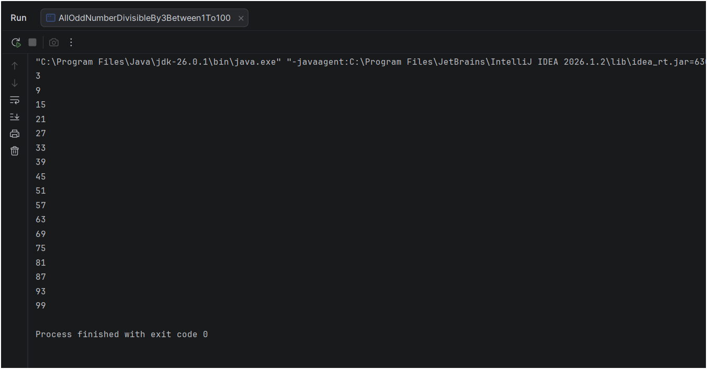

## Java Practice Question – Odd Numbers Divisible by 3 (1 to 100)

This folder contains a Java program that solves a **basic practice question** demonstrating the use of loops and compound conditional statements to find and print numbers that meet multiple mathematical criteria within a specific range (1 to 100).

It is intended for beginners to strengthen their understanding of **core Java fundamentals**, specifically loop iteration, the modulo operator, and logical evaluation.

---

## 📌 Program Overview

The program in this folder covers the following practice concepts:

- Setting up a basic Java class and `main` method structure.
- Using a loop construct to iterate sequentially through a range of numbers from 1 to 100.
- Utilizing the modulo operator (`%`) to determine if a number is odd.
- Utilizing the modulo operator (`%`) again to check if the number is perfectly divisible by 3.
- Implementing an `if` statement (often combining conditions with the logical AND `&&` operator) to filter and print only the numbers that satisfy both constraints.

The program automatically iterates through the range and prints the matching numbers clearly in the console.

---

## 🧪 Code Functionality

The program demonstrates:

### Iteration and Compound Filtering Logic
- **Looping**: Iterates a variable (e.g., `i`) starting from 1 up to and including 100.
- **Odd Check (`i % 2 != 0`)**: Checks if the current number is odd by ensuring the remainder of division by 2 is not zero.
- **Divisibility Check (`i % 3 == 0`)**: Checks if the current number is evenly divisible by 3.
- **Combined Logic**: Both conditions must be met simultaneously for the number to be printed. For example, 9 is odd and divisible by 3, so it prints. 12 is divisible by 3 but is not odd, so it is bypassed.

The program is written in a **concise and readable format**, automatically executing without requiring user input.

---

## 🖥️ Output

The program executes the loop and prints all the correctly filtered numbers directly to the console.  
The complete console output for this practice question is shown below.

---

## 📂 File Information

- `AllOddNumberDivisibleBy3Between1To100.java` — Contains the practice question program  
- `Output.png` — Screenshot of console output  
- `README.md` — Folder documentation  

---
## 👨‍💻 Author

**MD Shahnawaz Noor**     
*Aspiring Data Scientist* 
   
GitHub: [https://github.com/shahnawaznoor2020-code](https://github.com/shahnawaznoor2020-code)             
Email: shahnawaznoor2020@gmaIl.com  
 
---

## ⭐ Note

These practice programs help build a strong foundation in Java.  
Mastering the ability to filter data within a loop using multiple conditions is a crucial skill for algorithm development and data processing.