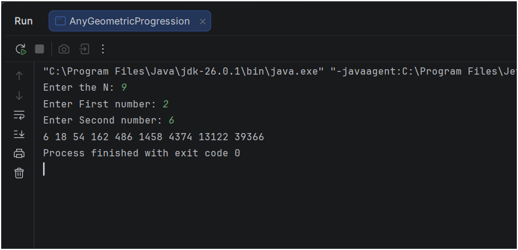

## Java Practice Question – Geometric Progression Generator

This folder contains a Java program that solves a **basic practice question** demonstrating the use of loops to generate and print a mathematical Geometric Progression (GP) series based on specified parameters.

It is intended for beginners to strengthen their understanding of **core Java fundamentals**, specifically loop iteration, variable updating through multiplication, and basic arithmetic operations.

---

## 📌 Program Overview

The program in this folder covers the following practice concepts:

- Setting up a basic Java class and `main` method structure.
- Using the `Scanner` class to read user input (such as the number of terms, starting number, and common ratio).
- Using a `for` or `while` loop to iterate and generate the sequence.
- Applying the mathematical logic of a Geometric Progression, where each subsequent term is generated by multiplying the previous term by a constant ratio.

The program calculates the sequence sequentially and prints the series clearly in the console.

---

## 🧪 Code Functionality

The program demonstrates:

### Sequence Generation Logic
- **Initialization**: Setting up the starting term of the progression.
- **Looping**: Using a loop to iterate for the desired number of terms ($n$).
- **Geometric Update**: Inside the loop, printing the current term and then updating it by multiplying it by the common ratio (e.g., `currentTerm *= commonRatio`).

### User Interaction
- Prompts the user for necessary sequence parameters.
- Reads the inputs using the `Scanner` class.

The program is written in a **simple and readable format**, displaying the step-by-step progression of the sequence.

---

## 🖥️ Output

The program executes the loop and prints the generated Geometric Progression directly to the console.  
The complete console output for this practice question is shown below.

---

## 📂 File Information

- `AnyGeometricProgression.java` — Contains the practice question program  
- `Output.png` — Screenshot of console output  
- `README.md` — Folder documentation  

---
## 👨‍💻 Author

**MD Shahnawaz Noor**     
*Aspiring Data Scientist* 
   
GitHub: [https://github.com/shahnawaznoor2020-code](https://github.com/shahnawaznoor2020-code)             
Email: shahnawaznoor2020@gmaIl.com  
 
---

## ⭐ Note

These practice programs help build a strong foundation in Java.  
Understanding how to translate mathematical formulas into iterative loops is a crucial skill for algorithm development and logic building.