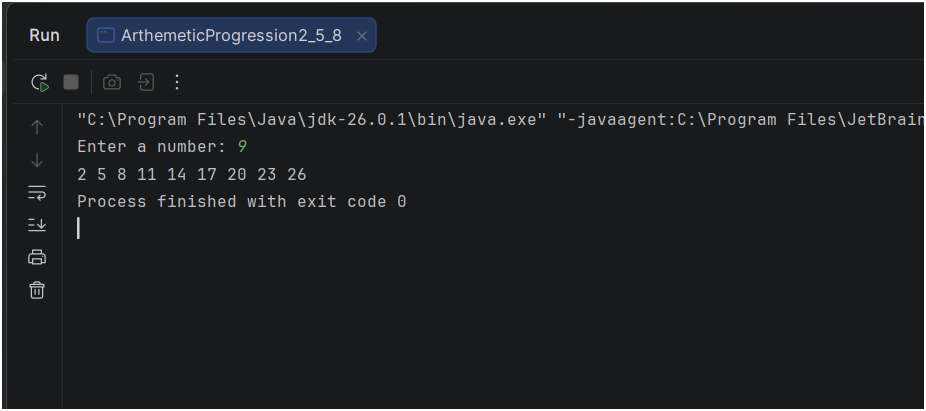

## Java Practice Question – Arithmetic Progression (2, 5, 8, ...)

This folder contains a Java program that solves a **basic practice question** demonstrating how to generate and print a specific arithmetic progression (AP) series starting with 2, 5, 8, and so on.

It is intended for beginners to strengthen their understanding of **core Java fundamentals**, specifically loop iteration and variable incrementation.

---

## 📌 Program Overview

The program in this folder covers the following practice concepts:

- Setting up a basic Java class and `main` method structure.
- Using the `Scanner` class to read an integer input ($N$) from the user, representing the number of terms to print.
- Using a loop (`for` or `while`) to iterate and generate the sequence.
- Understanding the mathematical properties of an Arithmetic Progression, specifically the initial term ($a = 2$) and the common difference ($d = 3$).

The program calculates the terms of the series and prints them sequentially in the console.

---

## 🧪 Code Functionality

The program demonstrates:

### Sequence Generation Logic
- **Initialization**: Sets the starting value of the sequence to 2.
- **Looping**: Iterates $N$ times based on the user's input.
- **Incrementation**: In each iteration, prints the current term and then adds the common difference of 3 to the variable to prepare it for the next iteration (e.g., `term += 3`).

### User Interaction
- Prompts the user for the number of terms they want to generate.
- Reads the input using the `Scanner` class.

The program is written in a **simple and readable format**, breaking down a standard mathematical series into basic programming loops.

---

## 🖥️ Output

The program executes the loop and prints the sequence directly to the console.  
The complete console output for this practice question is shown below.

---

## 📂 File Information

- `ArthemeticProgression2_5_8.java` — Contains the practice question program  
- `Output.png` — Screenshot of console output  
- `README.md` — Folder documentation  

---
## 👨‍💻 Author

**MD Shahnawaz Noor**     
*Aspiring Data Scientist* 
   
GitHub: [https://github.com/shahnawaznoor2020-code](https://github.com/shahnawaznoor2020-code)             
Email: shahnawaznoor2020@gmaIl.com  
 
---

## ⭐ Note

These practice programs help build a strong foundation in Java.  
Generating fixed sequences is a great way to master loop control structures and understand how variables change state over time.