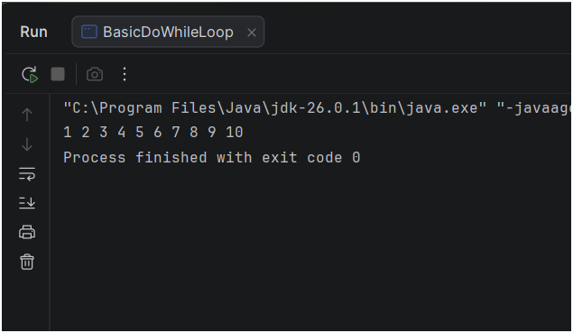

## Java Practice Question – Basic Do-While Loop

This folder contains a Java program that solves a **basic practice question** demonstrating the syntax and execution flow of a `do-while` loop.

It is intended for beginners to strengthen their understanding of **core Java fundamentals**, specifically focusing on exit-controlled loops.

---

## 📌 Program Overview

The program in this folder covers the following practice concepts:

- Setting up a basic Java class and `main` method structure.
- Understanding the structure and syntax of a `do-while` loop.
- Demonstrating how the `do` block guarantees at least one execution of the code inside it, regardless of the initial condition.
- Using a counter variable to manage the loop's execution and eventual termination.

The program executes a simple looping task and prints the results directly in the console.

---

## 🧪 Code Functionality

The program demonstrates:

### Exit-Controlled Loop Logic
- **Initialization**: A counter or control variable is set up before the loop begins.
- **`do` Block Execution**: The code inside the `do` block executes unconditionally for the first iteration. It typically includes printing a statement and updating the control variable (e.g., incrementing or decrementing).
- **`while` Condition Check**: After the block executes, the `while(condition);` statement is evaluated. If true, the loop repeats; if false, the loop terminates.

### Core Differences
Unlike `for` or standard `while` loops (which are entry-controlled and might never execute if the initial condition is false), this program highlights that a `do-while` loop always executes *at least once*.

The program is written in a **simple and readable format**, breaking down standard loop control structures.

---

## 🖥️ Output

The program executes the loop and prints the sequence or statements directly to the console.  
The complete console output for this practice question is shown below.

---

## 📂 File Information

- `BasicDoWhileLoop.java` — Contains the practice question program  
- `Output.png` — Screenshot of console output  
- `README.md` — Folder documentation  

---
## 👨‍💻 Author

**MD Shahnawaz Noor**     
*Aspiring Data Scientist* 
   
GitHub: [https://github.com/shahnawaznoor2020-code](https://github.com/shahnawaznoor2020-code)             
Email: shahnawaznoor2020@gmaIl.com  
 
---

## ⭐ Note

These practice programs help build a strong foundation in Java.  
Understanding the difference between entry-controlled (`for`, `while`) and exit-controlled (`do-while`) loops is crucial for handling menu-driven programs and user validation loops.