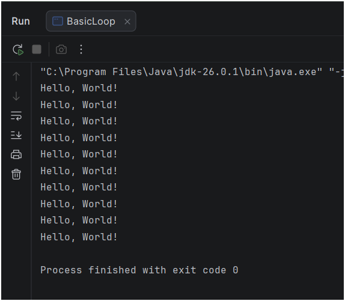

## Java Practice Question – Basic Loop

This folder contains a Java program that solves a **basic practice question** demonstrating the syntax and execution flow of a standard entry-controlled loop (such as a `for` or `while` loop).

It is intended for beginners to strengthen their understanding of **core Java fundamentals**, specifically focusing on repetitive execution based on a condition.

---

## 📌 Program Overview

The program in this folder covers the following practice concepts:

- Setting up a basic Java class and `main` method structure.
- Understanding the structure, syntax, and initialization of a standard loop.
- Demonstrating how entry-controlled loops operate, evaluating a condition before executing the block of code.
- Using a counter or iteration variable to manage the loop's lifecycle.

The program executes a simple repetitive task and prints the results directly in the console.

---

## 🧪 Code Functionality

The program demonstrates:

### Entry-Controlled Loop Logic
- **Initialization**: A counter or control variable is set up before or at the very beginning of the loop.
- **Condition Check**: The loop evaluates a boolean condition (e.g., `i <= 10`). If the condition is true, the loop body executes. If it is false, the loop terminates immediately.
- **Iteration/Update**: After the loop body executes, the control variable is updated (e.g., incremented with `i++` or decremented), and the condition is checked again.

### Core Differences
This program highlights standard iteration, forming the basis for iterating through arrays, processing sequences, or repeating a block of code a known number of times.

The program is written in a **simple and readable format**, breaking down the core elements of loop control structures.

---

## 🖥️ Output

The program executes the loop and prints the sequence directly to the console.  
The complete console output for this practice question is shown below.

---

## 📂 File Information

- `BasicLoop.java` — Contains the practice question program  
- `Output.png` — Screenshot of console output  
- `README.md` — Folder documentation  

---
## 👨‍💻 Author

**MD Shahnawaz Noor**     
*Aspiring Data Scientist* 
   
GitHub: [https://github.com/shahnawaznoor2020-code](https://github.com/shahnawaznoor2020-code)             
Email: shahnawaznoor2020@gmaIl.com  
 
---

## ⭐ Note

These practice programs help build a strong foundation in Java.  
Mastering basic loops is one of the most critical steps in programming, as they are essential for data processing, algorithm design, and automation.