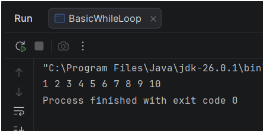

## Java Practice Question – Basic While Loop

This folder contains a Java program that solves a **basic practice question** demonstrating the syntax and execution flow of a `while` loop.

It is intended for beginners to strengthen their understanding of **core Java fundamentals**, specifically focusing on entry-controlled, condition-based iteration.

---

## 📌 Program Overview

The program in this folder covers the following practice concepts:

- Setting up a basic Java class and `main` method structure.
- Understanding the structure and syntax of a `while` loop.
- Demonstrating how entry-controlled loops operate by evaluating a boolean condition *before* executing the block of code.
- Managing loop control variables (initialization, condition checking, and updating).

The program executes a simple repetitive task and prints the sequence directly in the console.

---

## 🧪 Code Functionality

The program demonstrates:

### While Loop Logic
- **Initialization**: A control variable is initialized before the loop begins (e.g., `int i = 1;`).
- **Condition Check**: The `while` loop evaluates the condition (e.g., `while (i <= 10)`). 
  - If true, the loop body executes. 
  - If false, the loop terminates immediately, meaning a `while` loop might not execute even once if the initial condition is false.
- **Iteration/Update**: Inside the loop body, the control variable is updated (e.g., `i++`) to ensure the loop eventually terminates and does not become an infinite loop.

### Core Differences
Unlike a `for` loop where initialization, condition, and increment are grouped in one line, a `while` loop separates these elements, making it ideal for scenarios where the number of iterations is not known beforehand.

The program is written in a **simple and readable format**.

---

## 🖥️ Output

The program executes the loop and prints the sequence directly to the console.  
The complete console output for this practice question is shown below.

---

## 📂 File Information

- `BasicWhileLoop.java` — Contains the practice question program  
- `Output.png` — Screenshot of console output  
- `README.md` — Folder documentation  

---
## 👨‍💻 Author

**MD Shahnawaz Noor**     
*Aspiring Data Scientist* 
   
GitHub: [https://github.com/shahnawaznoor2020-code](https://github.com/shahnawaznoor2020-code)             
Email: shahnawaznoor2020@gmaIl.com  
 
---

## ⭐ Note

These practice programs help build a strong foundation in Java.  
Mastering the `while` loop is crucial for reading files, processing data streams, and handling user inputs where the exact number of iterations is unpredictable.