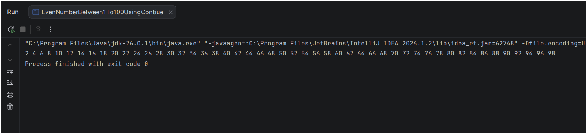

## Java Practice Question – Even Numbers (1 to 100) Using Continue

This folder contains a Java program that solves a **basic practice question** demonstrating the use of a loop combined with the `continue` statement to dynamically filter output.

It is intended for beginners to strengthen their understanding of **core Java fundamentals**, specifically loop control mechanisms and conditional skipping.

---

## 📌 Program Overview

The program in this folder covers the following practice concepts:

- Setting up a basic Java class and `main` method structure.
- Using a loop to iterate through a sequence of numbers from 1 to 100.
- Implementing the `continue` keyword to skip specific iterations based on a condition.
- Using the modulo operator (`%`) to mathematically identify odd numbers.

The program iterates through the sequence, intentionally skips the odd numbers, and prints only the even numbers to the console.

---

## 🧪 Code Functionality

The program demonstrates:

### Loop Control with `continue`
- **Iteration**: The loop systematically counts from 1 up to 100.
- **Condition Check**: Inside the loop, an `if` statement checks if the current number is odd (e.g., `if (i % 2 != 0)` or `if (i % 2 == 1)`).
- **The `continue` Keyword**: If the number is odd, the `continue` statement is triggered. This immediately halts the current iteration, skipping any remaining code in the loop body (like the `System.out.println` statement), and forces the loop to proceed directly to the next iteration.
- **Output Execution**: Only when the condition evaluates to false (meaning the number is even) does the program bypass the `continue` statement and execute the print command.

The program is written in a **simple and readable format**.

---

## 🖥️ Output

The program executes the loop and prints the filtered sequence of even numbers directly to the console.  
The complete console output for this practice question is shown below.

---

## 📂 File Information

- `EvenNumberBetween1To100UsingContiue.java` — Contains the practice question program  
- `Output.png` — Screenshot of console output  
- `README.md` — Folder documentation  

---
## 👨‍💻 Author

**MD Shahnawaz Noor**     
*Aspiring Data Scientist* 
   
GitHub: [https://github.com/shahnawaznoor2020-code](https://github.com/shahnawaznoor2020-code)             
Email: shahnawaznoor2020@gmaIl.com  
 
---

## ⭐ Note

These practice programs help build a strong foundation in Java.  
Understanding loop control statements like `continue` and `break` is essential for writing efficient code, filtering data streams, and managing complex iteration logic.