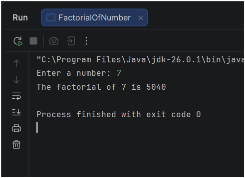

## Java Practice Question – Factorial of a Number

This folder contains a Java program that solves a **basic practice question** demonstrating the use of loops and accumulated multiplication to calculate the factorial of a given integer.

It is intended for beginners to strengthen their understanding of **core Java fundamentals**, specifically iterative processes and variable state updates.

---

## 📌 Program Overview

The program in this folder covers the following practice concepts:

- Setting up a basic Java class and `main` method structure.
- Using the `Scanner` class to read an integer input from the user.
- Initializing an accumulator variable to store the running product.
- Using a loop (such as a `for` loop) to iterate through a sequence of numbers from 1 up to the user's input $n$.

The program computes the mathematical factorial ($n!$) and displays the final result clearly in the console.

---

## 🧪 Code Functionality

The program demonstrates:

### Factorial Calculation Logic
- **Mathematical Concept**: The factorial of a non-negative integer $n$, denoted by $n!$, is the product of all positive integers less than or equal to $n$ ($n! = 1 \times 2 \times 3 \times \dots \times n$).
- **Accumulation**: A variable (e.g., `int fact = 1;`) is initialized to 1 before the loop begins.
- **Iteration**: Inside the loop, the accumulator is repeatedly multiplied by the loop control variable (`fact = fact * i;`).

### User Interaction
- Prompts the user for a number: `System.out.print("Enter a number: ");`
- Reads the input using `sc.nextInt();`.

The program is written in a **simple and readable format**.

---

## 🖥️ Output

The program executes the loop to compute the factorial and prints the final calculated value directly to the console.  
The complete console output for this practice question is shown below.

---

## 📂 File Information

- `FactorialOfNumber.java` — Contains the practice question program  
- `Output.png` — Screenshot of console output  
- `README.md` — Folder documentation  

---
## 👨‍💻 Author

**MD Shahnawaz Noor**     
*Aspiring Data Scientist* 
   
GitHub: [https://github.com/shahnawaznoor2020-code](https://github.com/shahnawaznoor2020-code)             
Email: shahnawaznoor2020@gmaIl.com  
 
---

## ⭐ Note

These practice programs help build a strong foundation in Java.  
Understanding how to accumulate values (like sums or products) using loops is a critical concept before diving into arrays and complex algorithms.