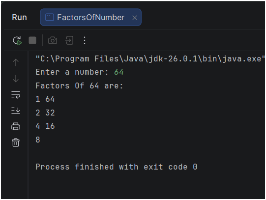

## Java Practice Question – Factors of a Number

This folder contains a Java program that solves a **basic practice question** demonstrating the use of loops and the modulo operator to find all mathematical factors (divisors) of a given integer.

It is intended for beginners to strengthen their understanding of **core Java fundamentals**, specifically iterative condition checking and arithmetic divisibility.

---

## 📌 Program Overview

The program in this folder covers the following practice concepts:

- Setting up a basic Java class and `main` method structure.
- Using the `Scanner` class to read an integer input from the user.
- Using a loop (such as a `for` or `while` loop) to iterate through potential divisors.
- Using the modulo operator (`%`) within an `if` statement to check for perfect divisibility.

The program identifies all factors of the input number and displays them sequentially in the console.

---

## 🧪 Code Functionality

The program demonstrates:

### Factor Finding Logic
- **Mathematical Concept**: A factor is a number that divides evenly into another number. For a given integer $n$ and a potential factor $i$, $i$ is a factor if the division leaves a remainder of $0$.
- **Iteration & Condition**: The loop iterates a variable `i` from $1$ up to $n$ (or $n/2$). Inside the loop, the condition `if (n % i == 0)` checks if $i$ perfectly divides $n$.
- **Output**: Whenever the condition is met, the program prints the valid factor to the screen.

### User Interaction
- Prompts the user for an integer input (e.g., `System.out.print("Enter a number: ");`).
- Reads the input using `sc.nextInt();`.

The program is written in a **simple and readable format**.

---

## 🖥️ Output

The program executes the loop and prints all identified factors directly to the console.  
The complete console output for this practice question is shown below.

---

## 📂 File Information

- `FactorsOfNumber.java` — Contains the practice question program  
- `Output.png` — Screenshot of console output  
- `README.md` — Folder documentation  

---
## 👨‍💻 Author

**MD Shahnawaz Noor**     
*Aspiring Data Scientist* 
   
GitHub: [https://github.com/shahnawaznoor2020-code](https://github.com/shahnawaznoor2020-code)             
Email: shahnawaznoor2020@gmaIl.com  
 
---

## ⭐ Note

These practice programs help build a strong foundation in Java.  
Understanding how to combine loops with conditional modulo checks is a critical step for solving mathematical and algorithmic problems.