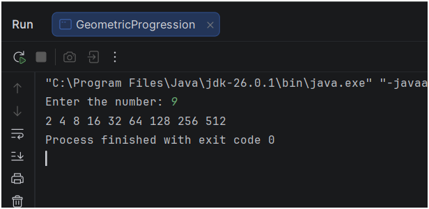

## Java Practice Question – Geometric Progression

This folder contains a Java program that solves a **basic practice question** demonstrating the use of loops to generate and print a simple geometric progression series (where each term is multiplied by a common ratio to get the next term).

It is intended for beginners to strengthen their understanding of **core Java fundamentals**, specifically iterative logic and sequential variable updating.

---

## 📌 Program Overview

The program in this folder covers the following practice concepts:

- Setting up a basic Java class and `main` method structure.
- Using the `Scanner` class to read an integer input from the user (typically the number of terms, $n$).
- Initializing a starting variable and a loop counter.
- Using a loop (such as a `for` loop) to calculate and print the series sequentially.
- Reassigning and updating a variable mathematically during each loop iteration.

The program calculates the sequence step-by-step and displays it continuously in the console.

---

## 🧪 Code Functionality

The program demonstrates:

### Progression Logic
- **Mathematical Concept**: A geometric progression (GP) is a sequence of numbers where each term after the first is found by multiplying the previous one by a fixed, non-zero number called the common ratio (e.g., $1, 2, 4, 8, 16...$ where the ratio is $2$).
- **Iteration**: The loop iterates from $1$ up to $n$ to generate exactly $n$ terms.
- **Variable Update**: Inside the loop, the current term is printed, and then updated for the next iteration using multiplication (e.g., $a = a \times r$, where $a$ is the term and $r$ is the common ratio).

### User Interaction
- Prompts the user for the number of terms they want to generate: `System.out.print("Enter number of terms: ");`.
- Reads the input using `sc.nextInt();`.

The program is written in a **simple and readable format**.

---

## 🖥️ Output

The program executes the loop and prints the generated geometric progression directly to the console.  
The complete console output for this practice question is shown below.

---

## 📂 File Information

- `GeometricProgression.java` — Contains the practice question program  
- `Output.png` — Screenshot of console output  
- `README.md` — Folder documentation  

---
## 👨‍💻 Author

**MD Shahnawaz Noor**     
*Aspiring Data Scientist* 
   
GitHub: [https://github.com/shahnawaznoor2020-code](https://github.com/shahnawaznoor2020-code)             
Email: shahnawaznoor2020@gmaIl.com  
 
---

## ⭐ Note

These practice programs help build a strong foundation in Java.  
Understanding how variables hold state and update within a loop is a fundamental concept for all algorithmic programming.