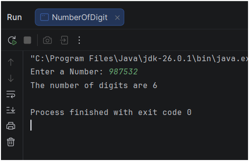

## Java Practice Question – Count Number of Digits

This folder contains a Java program that solves a **basic practice question** demonstrating how to count the total number of digits in a given integer using a loop and basic arithmetic operations.

It is intended for beginners to strengthen their understanding of **core Java fundamentals**, specifically `while` loops and number manipulation.

---

## 📌 Program Overview

The program in this folder covers the following practice concepts:

- Setting up a basic Java class and `main` method structure.
- Using the `Scanner` class to read an integer input from the user.
- Using a `while` loop to repeatedly process the number until it reaches zero.
- Utilizing integer division (`/`) to systematically remove the last digit of the number.
- Maintaining a counter variable to keep track of how many digits have been removed.

The program calculates the total digit count and displays it clearly in the console.

---

## 🧪 Code Functionality

The program demonstrates:

### Digit Counting Logic
- **Initialization**: A counter variable (e.g., `count = 0`) is initialized before the loop.
- **Loop Condition**: A `while` loop runs as long as the number is greater than 0 (e.g., `while (n > 0)` or `while (n != 0)`).
- **Digit Removal**: Inside the loop, the number is divided by 10 (`n = n / 10`). Because it is integer division, the decimal part is discarded, effectively dropping the last digit (e.g., `123 / 10` becomes `12`).
- **Incrementing Counter**: With each digit removed, the counter is incremented by 1 (`count++`).

### User Interaction
- Prompts the user to enter a number: `System.out.print("Enter a number: ");`
- Reads the input using `sc.nextInt();`.

The program is written in a **simple and readable format**.

---

## 🖥️ Output

The program processes the integer and prints the final digit count directly to the console during execution.  
The complete console output for this practice question is shown below.

---

## 📂 File Information

- `NumberOfDigit.java` — Contains the practice question program  
- `Output.png` — Screenshot of console output  
- `README.md` — Folder documentation  

---
## 👨‍💻 Author

**MD Shahnawaz Noor**     
*Aspiring Data Scientist* 
   
GitHub: [https://github.com/shahnawaznoor2020-code](https://github.com/shahnawaznoor2020-code)             
Email: shahnawaznoor2020@gmaIl.com  
 
---

## ⭐ Note

These practice programs help build a strong foundation in Java.  
Understanding how to isolate and manipulate individual digits of a number is a crucial step before moving on to more complex algorithms like checking for palindromes or Armstrong numbers.