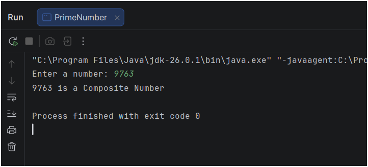
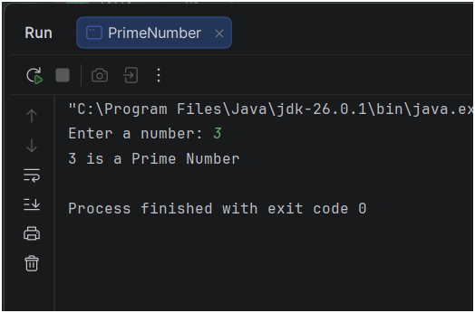

## Java Practice Question – Prime Number Checker

This folder contains a Java program that solves a **basic practice question** demonstrating how to determine if a given integer is a prime number using loops and conditional statements.

It is intended for beginners to strengthen their understanding of **core Java fundamentals**, specifically loop control, mathematical logic, and the modulo operator.

---

## 📌 Program Overview

The program in this folder covers the following practice concepts:

- Setting up a basic Java class and `main` method structure.
- Using the `Scanner` class to read an integer input from the user.
- Utilizing a `for` or `while` loop to iterate through potential divisors.
- Using the modulo operator (`%`) to check for remainders and determine divisibility.
- Implementing logical flags (boolean variables) or counter variables to track if a divisor was found.

The program evaluates the number and outputs whether it is a "Prime Number" or a composite/non-prime number clearly in the console.

---

## 🧪 Code Functionality

The program demonstrates:

### Prime Number Evaluation Logic
- **Definition**: A prime number is a natural number greater than $1$ that is only divisible by $1$ and itself.
- **Divisibility Check**: The loop checks for factors by dividing the input number $n$ by every integer $i$ from $2$ up to $n-1$ (or $n/2$). 
- **Condition**: Inside the loop, it uses the condition `if (n % i == 0)`. If this evaluates to true, it means $n$ is divisible by $i$, making it a composite number, not prime.
- **Optimization (Optional)**: Often, a `break` statement is used to exit the loop early as soon as the first divisor is found.

### User Interaction
- Prompts the user to enter a number: `System.out.print("Enter a number: ");`
- Reads the input using `sc.nextInt();`.

The program is written in a **simple and readable format**.

---

## 🖥️ Output

The program evaluates the input and prints the prime status directly to the console during execution.  
The complete console outputs for this practice question (testing different cases) are shown below.

### Output 1 (e.g., Prime Number Case)

### Output 2 (e.g., Non-Prime/Composite Case)

---

## 📂 File Information

- `PrimeNumber.java` — Contains the practice question program  
- `Output_1.png` — Screenshot of console output (Test Case 1)  
- `Output_2.png` — Screenshot of console output (Test Case 2)  
- `README.md` — Folder documentation  

---
## 👨‍💻 Author

**MD Shahnawaz Noor**     
*Aspiring Data Scientist* 
   
GitHub: [https://github.com/shahnawaznoor2020-code](https://github.com/shahnawaznoor2020-code)             
Email: shahnawaznoor2020@gmaIl.com  
 
---

## ⭐ Note

These practice programs help build a strong foundation in Java.  
Understanding prime number logic is a classic algorithmic milestone and is foundational for tasks involving cryptography, factoring, and advanced mathematical computations.