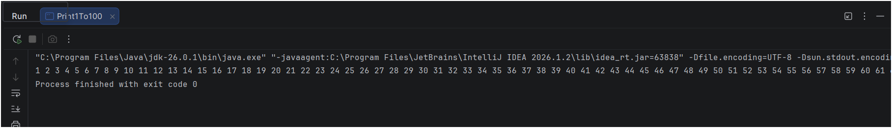

## Java Practice Question – Print Numbers 1 to 100

This folder contains a Java program that solves a **basic practice question** demonstrating how to use loops to print a continuous sequence of numbers from 1 to 100.

It is intended for beginners to strengthen their understanding of **core Java fundamentals**, specifically loop structures, iteration, and console output.

---

## 📌 Program Overview

The program in this folder covers the following practice concepts:

- Setting up a basic Java class and `main` method structure.
- Utilizing a `for` or `while` loop to execute a block of code repeatedly.
- Understanding loop initialization, condition evaluation, and incrementation.
- Printing output to the console sequentially using `System.out.println()`.

The program iterates a hundred times, printing the current counter variable to the screen during each iteration.

---

## 🧪 Code Functionality

The program demonstrates:

### Iteration Logic
- **Initialization**: Sets a starting counter variable, typically `int i = 1;`.
- **Condition**: Checks if the counter has reached the upper limit before executing the loop body (`i <= 100`).
- **Increment**: Increases the counter variable by 1 after each successful print statement (`i++`).

The program is written in a **simple and readable format**, making it a perfect introductory exercise for grasping how iterative control flow works.

---

## 🖥️ Output

The program evaluates the loop conditions and prints each number directly to the console during execution.  
The complete console output for this practice question is shown below.

---

## 📂 File Information

- `Print1To100.java` — Contains the practice question program  
- `Output.png` — Screenshot of console output  
- `README.md` — Folder documentation  

---
## 👨‍💻 Author

**MD Shahnawaz Noor**     
*Aspiring Data Scientist* 
   
GitHub: [https://github.com/shahnawaznoor2020-code](https://github.com/shahnawaznoor2020-code)             
Email: shahnawaznoor2020@gmaIl.com  
 
---

## ⭐ Note

These practice programs help build a strong foundation in Java.  
Mastering basic loops is the first step towards understanding more complex array manipulations, data processing, and advanced algorithmic thinking.