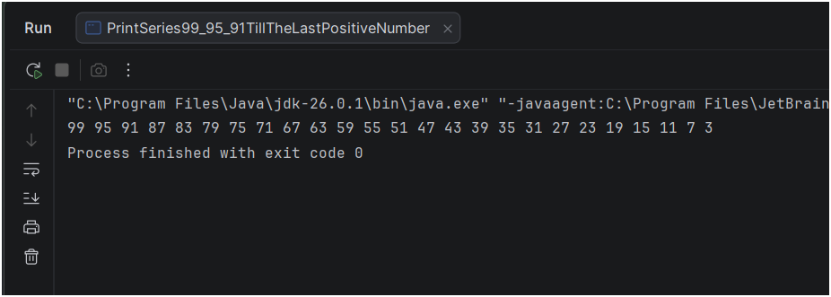

## Java Practice Question – Print Series (99, 95, 91...) Till Last Positive Number

This folder contains a Java program that solves a **basic practice question** demonstrating how to generate and print a decreasing arithmetic progression sequence starting from $99$ with a common difference of $-4$, stopping right before the terms become zero or negative.

It is intended for beginners to strengthen their understanding of **core Java fundamentals**, specifically loop termination conditions, custom step decrements, and sequence generation.

## 📌 Program Overview

The program in this folder covers the following practice concepts:

* Setting up a basic Java class and `main` method structure.

* Initializing a loop variable at a specific starting value ($99$).

* Using a loop (`for` or `while`) with a positive boundary condition (`> 0`).

* Applying a custom step decrement (`i -= 4` or `i = i - 4`) to generate the series.

* Printing the generated sequence to the console using `System.out.println()` or `System.out.print()`.

The program prints the sequence `99, 95, 91, ..., 3`, terminating automatically once the next value would drop below $1$.

## 🧪 Code Functionality

The program demonstrates:

### Decreasing Sequence Generation

* **Initialization**: Starts the sequence counter at the first term of the progression (`int i = 99;`).

* **Condition**: Ensures the loop continues only while the current term remains strictly positive (`i > 0`).

* **Custom Step Decrement**: Subtracts $4$ from the current value after each iteration (`i -= 4`), producing the next term in the series ($99, 95, 91, \dots, 7, 3$).

The program is written in a **simple and readable format**, making it a great exercise for practicing non-unitary loop steps and boundary conditions without needing to pre-calculate the total number of terms.

## 🖥️ Output

The program executes the loop and prints each positive term of the decreasing arithmetic progression directly to the console.

The complete console output for this practice question is shown below:

## 📂 File Information

* `PrintSeries99_95_91TillTheLastPositiveNumber.java` — Contains the practice question program

* `Output.png` — Screenshot of console output

* `README.md` — Folder documentation

## 👨‍💻 Author

**MD Shahnawaz Noor**

*Aspiring Data Scientist*

GitHub: <https://github.com/shahnawaznoor2020-code>

Email: shahnawaznoor2020@gmaIl.com

## ⭐ Note

These practice programs help build a strong foundation in Java.

Mastering condition-based loop termination (rather than relying solely on a fixed iteration count) is vital for handling dynamic sequences, convergence algorithms, and boundary-driven logic.