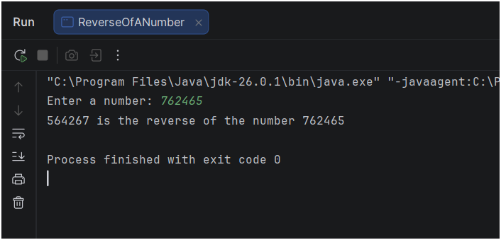

## Java Practice Question – Reverse of a Number

This folder contains a Java program that solves a **basic practice question** demonstrating how to reverse the digits of a given integer using arithmetic operators and a loop.

It is intended for beginners to strengthen their understanding of **core Java fundamentals**, specifically digit extraction using the modulo operator (`%`), integer division (`/`), and constructing a reversed number iteratively.

## 📌 Program Overview

The program in this folder covers the following practice concepts:

* Reading an integer input from the user using `Scanner`.

* Using a `while` loop that runs until the original number becomes $0$.

* Extracting the last digit of the number using the modulo operator (`n % 10`).

* Building the reversed number by multiplying the existing reversed value by $10$ and adding the extracted digit (`rev = rev * 10 + lastDigit`).

* Removing the last digit from the original number using integer division (`n = n / 10`).

* Printing the final reversed integer to the console using `System.out.println()`.

## 🧪 Code Functionality

The program demonstrates:

### Iterative Digit Reversal

* **Digit Extraction**: On each iteration, `n % 10` isolates the rightmost digit of the current number.

* **Place Value Shifting**: Multiplying the accumulated `rev` variable by $10$ shifts its existing digits one place to the left, making room for the newly extracted digit in the units place.

* **Number Truncation**: Dividing `n` by $10$ discards the processed rightmost digit, gradually reducing `n` toward $0$ to terminate the loop.

The program is written in a **simple and readable format**, serving as a foundational building block for related problems such as checking for palindrome numbers.

## 🖥️ Output

The program prompts the user for an integer, reverses its digits, and displays the resulting number in the console.

The complete console output for this practice question is shown below:

## 📂 File Information

* `ReverseOfANumber.java` — Contains the practice question program

* `Output.png` — Screenshot of console output

* `README.md` — Folder documentation

## 👨‍💻 Author

**MD Shahnawaz Noor**

*Aspiring Data Scientist*

GitHub: <https://github.com/shahnawaznoor2020-code>

Email: shahnawaznoor2020@gmail.com

## ⭐ Note

These practice programs help build a strong foundation in Java.

Understanding how to manipulate individual digits with `%` and `/` is essential for solving number-theory problems, validating inputs, and working with mathematical algorithms.