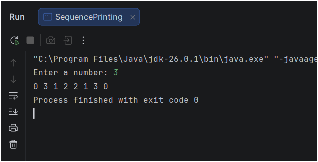

## Java Practice Question – Sequence Printing

This folder contains a Java program that solves a **basic practice question** demonstrating how to generate and print a specific numerical sequence using loops and iterative logic.

It is intended for beginners to strengthen their understanding of **core Java fundamentals**, specifically loop control, variable updates, and pattern-based sequence generation.

## 📌 Program Overview

The program in this folder covers the following practice concepts:

* Reading the number of terms or upper limit $n$ from the user using `Scanner`.

* Initializing starting terms or counters to establish the pattern of the sequence.

* Using a loop (`for` or `while`) to iterate through the sequence generation steps.

* Updating sequence variables dynamically on each iteration according to the pattern rule.

* Printing each term of the sequence clearly to the console using `System.out.print()` or `System.out.println()`.

## 🧪 Code Functionality

The program demonstrates:

### Iterative Sequence Generation

* **Pattern Control**: Uses structured loop iterations to compute consecutive elements in a series without hardcoding values.

* **State Progression**: Updates loop or sequence tracking variables step-by-step to produce predictable, ordered numerical output.

The program is written in a **simple and readable format**, making it ideal for beginners practicing algorithmic thinking and loop mechanics.

## 🖥️ Output

The program takes the required limit from the user and prints the generated sequence in the console.

The complete console output for this practice question is shown below:

## 📂 File Information

* `SequencePrinting.java` — Contains the practice question program

* `Output.png` — Screenshot of console output

* `README.md` — Folder documentation

## 👨‍💻 Author

**MD Shahnawaz Noor**

*Aspiring Data Scientist*

GitHub: <https://github.com/shahnawaznoor2020-code>

Email: shahnawaznoor2020@gmail.com

## ⭐ Note

These practice programs help build a strong foundation in Java.

Mastering sequence printing helps develop problem-solving skills around loop boundaries, step increments, and pattern recognition.