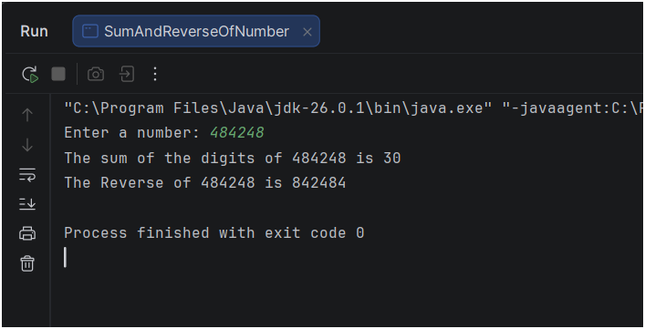

## Java Practice Question – Sum and Reverse of a Number

This folder contains a Java program that solves a **basic practice question** demonstrating how to extract digits from an integer to simultaneously calculate the sum of its digits and construct its reversed number.

It is intended for beginners to strengthen their understanding of **core Java fundamentals**, specifically `while` loops, arithmetic operators (modulo `%` and integer division `/`), and digit manipulation.

## 📌 Program Overview

The program in this folder covers the following practice concepts:

* Reading an integer input $n$ from the user using `Scanner`.

* Initializing accumulator variables (`sum = 0` and `reverse = 0`) before entering the loop.

* Using a `while` loop (`n != 0` or `n > 0`) to process each digit of the number one by one.

* Extracting the last digit using the modulo operator (`digit = n % 10`).

* Adding the extracted digit to the running total (`sum += digit`) and building the reversed integer (`reverse = reverse * 10 + digit`).

* Removing the processed last digit via integer division (`n = n / 10`) and printing both final results to the console.

## 🧪 Code Functionality

The program demonstrates:

### Digit Extraction & Dual Accumulation

* **Digit Isolation**: Uses base-10 modulo arithmetic (`% 10`) to isolate the rightmost digit on each iteration until all digits are processed.

* **Simultaneous Calculation**: Combines summation and positional reversal (`* 10 + digit`) within a single pass over the number's digits.

The program is written in a **simple and readable format**, making it ideal for beginners practicing number-based algorithmic logic.

## 🖥️ Output

The program takes an integer from the user and prints both the sum of its digits and its reversed value in the console.

The complete console output for this practice question is shown below:

## 📂 File Information

* `SumAndReverseOfNumber.java` — Contains the practice question program

* `Output.png` — Screenshot of console output

* `README.md` — Folder documentation

## 👨‍💻 Author

**MD Shahnawaz Noor**

*Aspiring Data Scientist*

GitHub: <https://github.com/shahnawaznoor2020-code>

Email: shahnawaznoor2020@gmail.com

## ⭐ Note

These practice programs help build a strong foundation in Java.

Mastering digit extraction with modulo and division is essential for solving classic number-theory problems such as palindrome checks and Armstrong numbers.