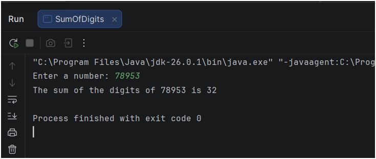

## Java Practice Question – Sum of Digits

This folder contains a Java program that solves a **basic practice question** demonstrating how to extract individual digits from an integer and calculate their total sum.

It is intended for beginners to strengthen their understanding of **core Java fundamentals**, specifically `while` loops, arithmetic operators (modulo `%` and integer division `/`), and accumulator variables.

## 📌 Program Overview

The program in this folder covers the following practice concepts:

* Reading an integer input $n$ from the user using `Scanner`.

* Initializing an accumulator variable (`sum = 0`) to store the running total of the digits.

* Using a `while` loop (`n != 0` or `n > 0`) to iterate through each digit of the integer.

* Extracting the rightmost digit using the modulo operator (`digit = n % 10`) and adding it to `sum`.

* Removing the processed last digit via integer division (`n = n / 10`) until no digits remain, then printing the final sum to the console.

## 🧪 Code Functionality

The program demonstrates:

### Digit Extraction & Summation

* **Modulo Arithmetic (`% 10`)**: Isolates the last digit of a base-10 integer on each pass of the loop.

* **Integer Truncation (`/ 10`)**: Discards the rightmost digit cleanly so the next iteration processes the subsequent place value.

The program is written in a **simple and readable format**, making it ideal for beginners practicing number-based algorithmic logic.

## 🖥️ Output

The program takes an integer from the user and prints the sum of all its digits in the console.

The complete console output for this practice question is shown below:

## 📂 File Information

* `SumOfDigits.java` — Contains the practice question program

* `Output.png` — Screenshot of console output

* `README.md` — Folder documentation

## 👨‍💻 Author

**MD Shahnawaz Noor**

*Aspiring Data Scientist*

GitHub: <https://github.com/shahnawaznoor2020-code>

Email: shahnawaznoor2020@gmail.com

## ⭐ Note

These practice programs help build a strong foundation in Java.

Understanding how to break numbers down digit by digit is a key building block for tackling more advanced problems like Armstrong numbers, harshad numbers, and digit-root calculations.