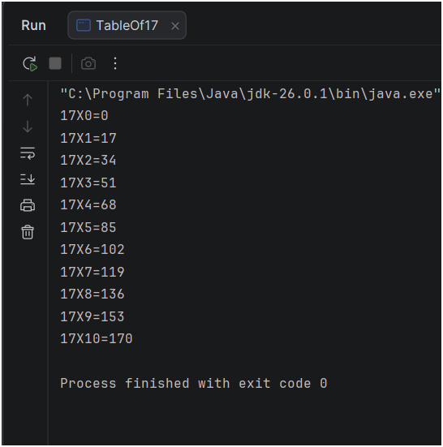

## Java Practice Question – Multiplication Table of 17

This folder contains a Java program that solves a **basic practice question** demonstrating how to generate and print the multiplication table of 17 using iterative loops.

It is intended for beginners to strengthen their understanding of **core Java fundamentals**, specifically loop counters, arithmetic multiplication, and formatted console output.

## 📌 Program Overview

The program in this folder covers the following practice concepts:

* Using a `for` loop to iterate through multipliers from $1$ to $10$ (or incrementing by $17$ from $17$ to $170$).

* Calculating each multiple of $17$ dynamically during every iteration of the loop.

* Printing the multiplication sequence cleanly to the console using `System.out.println()`.

## 🧪 Code Functionality

The program demonstrates:

### Iterative Table Generation

* **Loop Control**: Repeats the multiplication logic a fixed number of times (typically 10 iterations) using a counter variable.

* **Arithmetic Operations**: Multiplies the base number (`17`) by the loop counter on each pass to produce the standard multiplication table.

The program is written in a **simple and readable format**, making it ideal for beginners practicing repetitive arithmetic tasks in Java.

## 🖥️ Output

The program prints the complete multiplication table of 17 in the console.

The complete console output for this practice question is shown below:

## 📂 File Information

* `TableOf17.java` — Contains the practice question program

* `Output.png` — Screenshot of console output

* `README.md` — Folder documentation

## 👨‍💻 Author

**MD Shahnawaz Noor**

*Aspiring Data Scientist*

GitHub: <https://github.com/shahnawaznoor2020-code>

Email: shahnawaznoor2020@gmail.com

## ⭐ Note

These practice programs help build a strong foundation in Java.

Mastering loop-based multiplication tables builds the intuition needed for nested loops, pattern printing, and matrix operations.