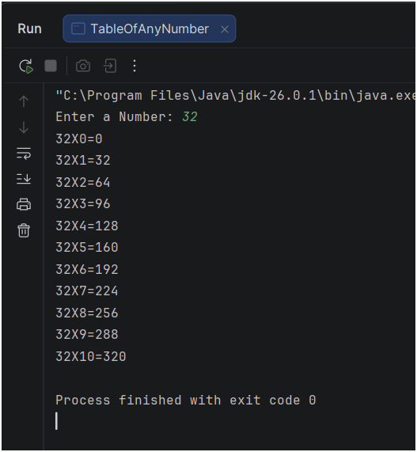

## Java Practice Question – Multiplication Table of Any Number

This folder contains a Java program that solves a **basic practice question** demonstrating how to generate and print the multiplication table of any user-provided number using `Scanner` input and iterative loops.

It is intended for beginners to strengthen their understanding of **core Java fundamentals**, specifically user input handling, loop counters, arithmetic multiplication, and formatted console output.

## 📌 Program Overview

The program in this folder covers the following practice concepts:

* Reading an integer input (`n`) from the user using the `Scanner` class.

* Using a `for` loop to iterate through multipliers from $1$ to $10$.

* Dynamically calculating and displaying each multiple of the entered number during every iteration of the loop.

## 🧪 Code Functionality

The program demonstrates:

### Dynamic Table Generation

* **User Input**: Prompts the user to enter a number whose multiplication table they wish to view.

* **Loop Control & Arithmetic**: Uses a counter variable from $1$ to $10$ to multiply the input number on each pass and print the formatted result using `System.out.println()`.

The program is written in a **simple and readable format**, making it ideal for beginners practicing interactive arithmetic tasks in Java.

## 🖥️ Output

The program prompts the user for a number and prints its complete multiplication table in the console.

The complete console output for this practice question is shown below:

## 📂 File Information

* `TableOfAnyNumber.java` — Contains the practice question program

* `Output.png` — Screenshot of console output

* `README.md` — Folder documentation

## 👨‍💻 Author

**MD Shahnawaz Noor**

*Aspiring Data Scientist*

GitHub: <https://github.com/shahnawaznoor2020-code>

Email: shahnawaznoor2020@gmail.com

## ⭐ Note

These practice programs help build a strong foundation in Java.

Combining user input with loop-based calculations builds the core intuition needed for interactive console applications and algorithmic problem-solving.