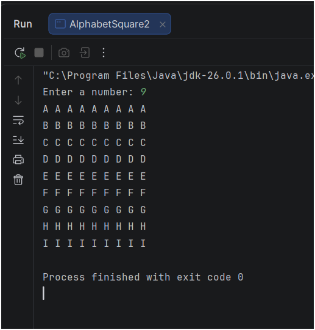

## Java Practice Question – Alphabet Square Pattern (Variation 2)

This folder contains a Java program that solves a **basic pattern-printing practice question** demonstrating an alternative approach to generating a square grid of alphabetical characters (such as repeating row letters `A A A`, `B B B`, `C C C`, ... or uppercase/lowercase variations) using nested loops and ASCII values.

It is intended for beginners to strengthen their understanding of **core Java fundamentals**, specifically nested `for` loops, character data types (`char`), row-based vs. column-based character mapping, and console formatting.

## 📌 Program Overview

The program in this folder covers the following practice concepts:

* Reading the grid dimension (`n`) from the user using the `Scanner` class.

* Using an outer `for` loop to control the number of rows in the square pattern.

* Using an inner `for` loop to print characters across each column based on the loop index.

* Converting integer indices into corresponding ASCII characters using `(char)` type casting.

## 🧪 Code Functionality

The program demonstrates:

### Nested Loops & Row-Based Character Pattern Generation

* **User Input**: Prompts the user to enter the size (`n`) for the square grid.

* **Grid Iteration**: Uses nested `for` loops running $n$ times each to form an $n \times n$ grid structure, printing alphabetical characters determined by the loop counter and moving to a new line with `System.out.println()` after each row completes.

The program is written in a **simple and readable format**, making it ideal for beginners practicing nested loop logic and character manipulation in Java.

## 🖥️ Output

The program prompts the user for the grid size and prints the resulting alphabet square pattern in the console.

The complete console output for this practice question is shown below:

## 📂 File Information

* `AlphabetSquare2.java` — Contains the practice question program

* `Output.png` — Screenshot of console output

* `README.md` — Folder documentation

## 👨‍💻 Author

**MD Shahnawaz Noor**

*Aspiring Data Scientist*

GitHub: <https://github.com/shahnawaznoor2020-code>

Email: shahnawaznoor2020@gmail.com

## ⭐ Note

These practice programs help build a strong foundation in Java.

Practicing different variations of alphabet patterns reinforces your control over outer and inner loop variables and deepens your understanding of ASCII character arithmetic.