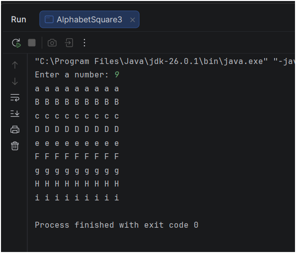

## Java Practice Question – Alphabet Square Pattern (Variation 3)

This folder contains a Java program that solves a **basic pattern-printing practice question** demonstrating another variation of generating a square grid of alphabetical characters (such as continuous incrementing letters across rows, alternating case patterns, or custom ASCII offsets) using nested loops and character arithmetic.

It is intended for beginners to strengthen their understanding of **core Java fundamentals**, specifically nested `for` loops, character data types (`char`), independent counter variables or ASCII manipulation, and console formatting.

## 📌 Program Overview

The program in this folder covers the following practice concepts:

* Reading the grid dimension (`n`) from the user using the `Scanner` class.

* Using an outer `for` loop to control the number of rows in the square pattern.

* Using an inner `for` loop to print characters across each column with custom progression or case logic.

* Converting integer values or incrementing `char` variables directly to print structured alphabetical output.

## 🧪 Code Functionality

The program demonstrates:

### Nested Loops & Advanced Alphabet Pattern Logic

* **User Input**: Prompts the user to enter the size (`n`) for the square grid.

* **Grid Iteration**: Uses nested `for` loops running $n$ times each to form an $n \times n$ grid structure, updating and printing alphabetical characters across rows and columns before moving to a new line with `System.out.println()`.

The program is written in a **simple and readable format**, making it ideal for beginners practicing nested loop logic and character manipulation in Java.

## 🖥️ Output

The program prompts the user for the grid size and prints the resulting alphabet square pattern in the console.

The complete console output for this practice question is shown below:

## 📂 File Information

* `AlphabetSquare3.java` — Contains the practice question program

* `Output.png` — Screenshot of console output

* `README.md` — Folder documentation

## 👨‍💻 Author

**MD Shahnawaz Noor**

*Aspiring Data Scientist*

GitHub: <https://github.com/shahnawaznoor2020-code>

Email: shahnawaznoor2020@gmail.com

## ⭐ Note

These practice programs help build a strong foundation in Java.

Practicing multiple variations of alphabet patterns strengthens your grasp of loop state management and ASCII character manipulation.