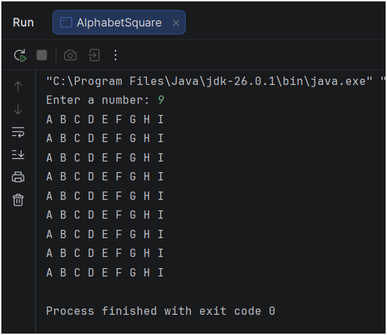

## Java Practice Question – Alphabet Square Pattern

This folder contains a Java program that solves a **basic pattern-printing practice question** demonstrating how to generate a square grid of alphabetical characters (`A`, `B`, `C`, ...) using nested loops and ASCII character manipulation.

It is intended for beginners to strengthen their understanding of **core Java fundamentals**, specifically nested `for` loops, character data types (`char`), type casting, and console formatting.

## 📌 Program Overview

The program in this folder covers the following practice concepts:

* Reading the grid dimension (`n`) from the user using the `Scanner` class.

* Using an outer `for` loop to control the number of rows in the square pattern.

* Using an inner `for` loop to print consecutive uppercase letters across each column.

* Converting integer offsets into corresponding ASCII characters using `(char)` type casting.

## 🧪 Code Functionality

The program demonstrates:

### Nested Loops & Character Pattern Generation

* **User Input**: Prompts the user to enter the number of rows/columns (`n`) for the square grid.

* **Row & Column Iteration**: Uses nested loops running $n$ times each to form an $n \times n$ grid structure, printing `A` through the $n$-th alphabet letter on every line before moving to a new line with `System.out.println()`.

The program is written in a **simple and readable format**, making it ideal for beginners practicing nested loop logic and character manipulation in Java.

## 🖥️ Output

The program prompts the user for the grid size and prints the resulting alphabet square pattern in the console.

The complete console output for this practice question is shown below:

## 📂 File Information

* `AlphabetSquare.java` — Contains the practice question program

* `Output.png` — Screenshot of console output

* `README.md` — Folder documentation

## 👨‍💻 Author

**MD Shahnawaz Noor**

*Aspiring Data Scientist*

GitHub: <https://github.com/shahnawaznoor2020-code>

Email: shahnawaznoor2020@gmail.com

## ⭐ Note

These practice programs help build a strong foundation in Java.

Mastering nested loops and ASCII character manipulation is a key step toward solving complex pattern-printing problems and understanding 2D grid structures.