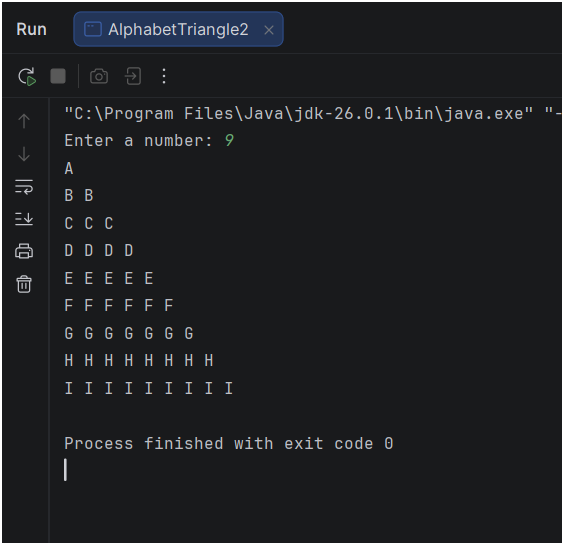

## Java Practice Question – Alphabet Triangle Pattern (Variation 2)

This folder contains a Java program that solves a **basic pattern-printing practice question** demonstrating how to generate a variation of a right-angled alphabet triangle using nested loops and character arithmetic.

It is intended for beginners to strengthen their understanding of **core Java fundamentals**, specifically nested `for` loops, row-dependent character values, ASCII manipulation, and console formatting.

## 📌 Program Overview

The program in this folder covers the following practice concepts:

* Reading the number of rows (`n`) from the user using the `Scanner` class.

* Using an outer `for` loop (`i` from `1` to `n`) to manage each row of the triangle.

* Using a dependent inner `for` loop (`j` from `1` to `i`) to print characters that correspond to the row index (such as `A`, `B B`, `C C C`) or lowercase alphabet sequences.

* Applying type casting (`(char)`) to convert integer offsets into alphabetical characters.

## 🧪 Code Functionality

The program demonstrates:

### Nested Loops & Row-Driven Character Patterns

* **User Input**: Prompts the user to enter the height (`n`) of the alphabet triangle.

* **Pattern Generation**: Uses an outer loop to track the row number and a bounded inner loop (`j <= i`) to print the corresponding alphabetical character across each row before advancing to a new line with `System.out.println()`.

The program is written in a **simple and readable format**, making it ideal for beginners exploring variations of triangular patterns in Java.

## 🖥️ Output

The program prompts the user for the number of rows and prints the resulting alphabet triangle pattern in the console.

The complete console output for this practice question is shown below:

## 📂 File Information

* `AlphabetTriangle2.java` — Contains the practice question program

* `Output.png` — Screenshot of console output

* `README.md` — Folder documentation

## 👨‍💻 Author

**MD Shahnawaz Noor**

*Aspiring Data Scientist*

GitHub: <https://github.com/shahnawaznoor2020-code>

Email: shahnawaznoor2020@gmail.com

## ⭐ Note

These practice programs help build a strong foundation in Java.

Exploring variations of triangle patterns deepens your intuition for how outer loop variables influence inner loop output.