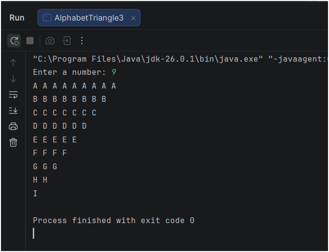

## Java Practice Question – Alphabet Triangle Pattern (Variation 3)

This folder contains a Java program that solves a **basic pattern-printing practice question** demonstrating how to generate a third variation of a right-angled alphabet triangle using nested loops, ASCII manipulation, and conditional or counter-based character logic.

It is intended for beginners to strengthen their understanding of **core Java fundamentals**, specifically nested `for` loops, character arithmetic, type casting, and console formatting.

## 📌 Program Overview

The program in this folder covers the following practice concepts:

* Reading the number of rows (`n`) from the user using the `Scanner` class.

* Using an outer `for` loop (`i` from `1` to `n`) to control the total number of rows in the triangle.

* Using a dependent inner `for` loop (`j` from `1` to `i`) to print alphabetical characters based on row/column indices, a continuous character counter, or alternating case rules.

* Applying explicit type casting (`(char)`) to convert integer ASCII values into readable characters.

## 🧪 Code Functionality

The program demonstrates:

### Nested Loops & Character Pattern Logic

* **User Input**: Prompts the user to enter the number of rows (`n`) for the pattern.

* **Pattern Generation**: Iterates through rows and columns using nested loops, printing the calculated alphabetical character on each line before advancing to the next row using `System.out.println()`.

The program is written in a **simple and readable format**, making it ideal for beginners exploring advanced variations of triangular character patterns in Java.

## 🖥️ Output

The program prompts the user for the number of rows and prints the resulting alphabet triangle pattern in the console.

The complete console output for this practice question is shown below:

## 📂 File Information

* `AlphabetTriangle3.java` — Contains the practice question program

* `Output.png` — Screenshot of console output

* `README.md` — Folder documentation

## 👨‍💻 Author

**MD Shahnawaz Noor**

*Aspiring Data Scientist*

GitHub: <https://github.com/shahnawaznoor2020-code>

Email: shahnawaznoor2020@gmail.com

## ⭐ Note

These practice programs help build a strong foundation in Java.

Practicing multiple variations of alphabet triangles reinforces mastery over nested loops and character manipulation.