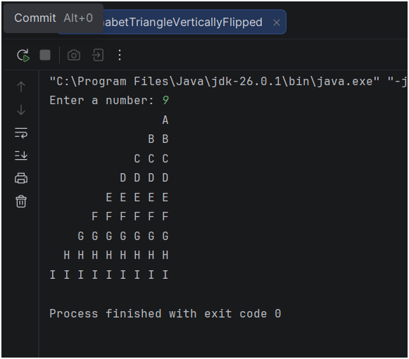

## Java Practice Question – Vertically Flipped Alphabet Triangle Pattern

This folder contains a Java program that solves a **pattern-printing practice question** demonstrating how to generate a vertically flipped (right-aligned) alphabet triangle using nested loops, leading spaces, and ASCII character manipulation.

It is intended for beginners to strengthen their understanding of **core Java fundamentals**, specifically managing multiple inner loops for alignment, character arithmetic, type casting, and console formatting.

## 📌 Program Overview

The program in this folder covers the following practice concepts:

* Reading the number of rows (`n`) from the user using the `Scanner` class.

* Using an outer `for` loop (`i` from `1` to `n`) to control the total number of rows in the pattern.

* Using a first inner `for` loop (`j` from `1` to `n - i`) to print leading spaces, shifting the characters to the right to create the vertically flipped alignment.

* Using a second inner `for` loop (`k` from `1` to `i`) to print alphabetical characters (e.g., `A`, `A B`, `A B C`) using explicit `(char)` type casting on ASCII values.

## 🧪 Code Functionality

The program demonstrates:

### Nested Loops & Right-Aligned Character Logic

* **User Input**: Prompts the user to enter the number of rows (`n`) for the pattern.

* **Pattern Generation**: For each row, prints the required number of leading spaces followed by the ascending sequence of alphabetical characters, moving to a new line with `System.out.println()` after each row completes.

The program is written in a **simple and readable format**, making it ideal for beginners learning how to control horizontal alignment alongside character patterns in Java.

## 🖥️ Output

The program prompts the user for the number of rows and prints the vertically flipped alphabet triangle pattern in the console.

The complete console output for this practice question is shown below:

## 📂 File Information

* `AlphabetTriangleVerticallyFlipped.java` — Contains the practice question program

* `Output.png` — Screenshot of console output

* `README.md` — Folder documentation

## 👨‍💻 Author

**MD Shahnawaz Noor**

*Aspiring Data Scientist*

GitHub: <https://github.com/shahnawaznoor2020-code>

Email: shahnawaznoor2020@gmail.com

## ⭐ Note

These practice programs help build a strong foundation in Java.

Practicing flipped and mirrored patterns reinforces mastery over multi-loop coordination and console layout control.