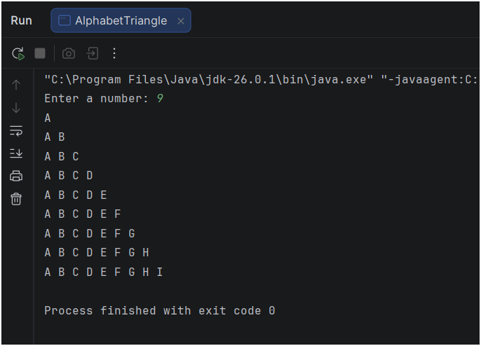

## Java Practice Question – Alphabet Triangle Pattern

This folder contains a Java program that solves a **basic pattern-printing practice question** demonstrating how to generate a right-angled triangle of alphabetical characters using nested loops and character arithmetic.

It is intended for beginners to strengthen their understanding of **core Java fundamentals**, specifically nested `for` loops, row-dependent loop boundaries, character data types (`char`), and console formatting.

## 📌 Program Overview

The program in this folder covers the following practice concepts:

* Reading the number of rows (`n`) from the user using the `Scanner` class.

* Using an outer `for` loop (`i` from `1` to `n`) to control the total number of rows in the triangle.

* Using a dependent inner `for` loop (`j` from `1` to `i`) to print an increasing number of alphabetical characters on each subsequent row.

* Converting integer indices or ASCII values into `char` values to display structured alphabetical rows.

## 🧪 Code Functionality

The program demonstrates:

### Nested Loops & Triangle Pattern Logic

* **User Input**: Prompts the user to enter the height (`n`) of the triangle.

* **Row-Dependent Iteration**: Uses an outer `for` loop for rows and an inner `for` loop bounded by the current row index (`j <= i`), printing alphabetical characters (e.g., `A`, `A B`, `A B C`) before moving to a new line with `System.out.println()`.

The program is written in a **simple and readable format**, making it ideal for beginners practicing triangle patterns and ASCII manipulation in Java.

## 🖥️ Output

The program prompts the user for the number of rows and prints the resulting alphabet triangle pattern in the console.

The complete console output for this practice question is shown below:

## 📂 File Information

* `AlphabetTriangle.java` — Contains the practice question program

* `Output.png` — Screenshot of console output

* `README.md` — Folder documentation

## 👨‍💻 Author

**MD Shahnawaz Noor**

*Aspiring Data Scientist*

GitHub: <https://github.com/shahnawaznoor2020-code>

Email: shahnawaznoor2020@gmail.com

## ⭐ Note

These practice programs help build a strong foundation in Java.

Transitioning from square grids to triangular patterns is a key milestone in mastering dependent nested loop boundaries.