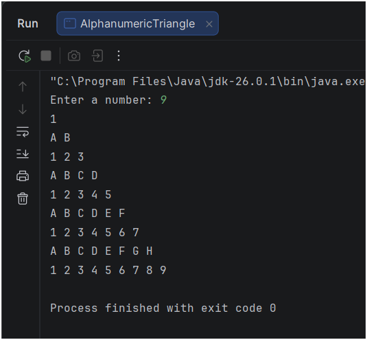

## Java Practice Question – Alphanumeric Triangle Pattern

This folder contains a Java program that solves a **pattern-printing practice question** demonstrating how to generate an alphanumeric triangle—alternating between numbers and uppercase letters across rows—using nested loops and conditional logic.

It is intended for beginners to strengthen their understanding of **core Java fundamentals**, specifically combining conditional branching (`if-else`) with nested `for` loops, ASCII character casting, and console formatting.

## 📌 Program Overview

The program in this folder covers the following practice concepts:

* Reading the number of rows (`n`) from the user using the `Scanner` class.

* Using an outer `for` loop (`i` from `1` to `n`) to manage the total number of rows in the triangle.

* Using an inner `for` loop (`j` from `1` to `i`) to print elements across each row.

* Using conditional logic (`i % 2 != 0`) to alternate between printing sequential numbers (`1`, `1 2 3`) on odd rows and sequential uppercase letters (`A B`, `A B C D`) on even rows via ASCII values and explicit `(char)` type casting.

## 🧪 Code Functionality

The program demonstrates:

### Nested Loops & Conditional Pattern Logic

* **User Input**: Prompts the user to enter the number of rows (`n`) for the pattern.

* **Pattern Generation**: Evaluates the current row index to decide whether to output digits or alphabetical characters, printing each row's elements and moving to a new line with `System.out.println()` once the row completes.

The program is written in a **simple and readable format**, making it ideal for beginners learning how to combine conditional statements with nested loops in Java.

## 🖥️ Output

The program prompts the user for the number of rows and prints the alternating alphanumeric triangle pattern in the console.

The complete console output for this practice question is shown below:

## 📂 File Information

* `AlphanumericTriangle.java` — Contains the practice question program

* `Output.png` — Screenshot of console output

* `README.md` — Folder documentation

## 👨‍💻 Author

**MD Shahnawaz Noor**

*Aspiring Data Scientist*

GitHub: <https://github.com/shahnawaznoor2020-code>

Email: shahnawaznoor2020@gmail.com

## ⭐ Note

These practice programs help build a strong foundation in Java.

Practicing hybrid patterns strengthens your ability to combine control flow statements with nested iteration.