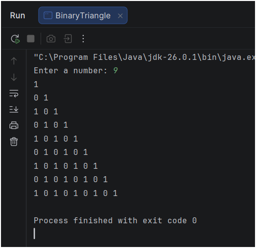

## Java Practice Question – Binary Triangle Pattern

This folder contains a Java program that solves a **pattern-printing practice question** demonstrating how to generate a right-angled binary triangle (alternating `1`s and `0`s) using nested loops and conditional logic.

It is intended for beginners to strengthen their understanding of **core Java fundamentals**, specifically combining parity checks (`(i + j) % 2 == 0`) with nested `for` loops and console formatting.

## 📌 Program Overview

The program in this folder covers the following practice concepts:

* Reading the number of rows (`n`) from the user using the `Scanner` class.

* Using an outer `for` loop (`i` from `1` to `n`) to control the total number of rows in the triangle.

* Using an inner `for` loop (`j` from `1` to `i`) to print elements across each row.

* Using conditional logic (`(i + j) % 2 == 0`) to alternate between printing `1` and `0` depending on whether the sum of the row and column indices is even or odd.

## 🧪 Code Functionality

The program demonstrates:

### Nested Loops & Parity-Based Pattern Logic

* **User Input**: Prompts the user to enter the number of rows (`n`) for the pattern.

* **Pattern Generation**: Evaluates the sum of row and column positions at each step to print `1` or `0`, moving to a new line with `System.out.println()` once each row completes.

The program is written in a **simple and readable format**, making it ideal for beginners learning how to apply mathematical conditions inside nested loops in Java.

## 🖥️ Output

The program prompts the user for the number of rows and prints the binary triangle pattern in the console.

The complete console output for this practice question is shown below:

## 📂 File Information

* `BinaryTriangle.java` — Contains the practice question program

* `Output.png` — Screenshot of console output

* `README.md` — Folder documentation

## 👨‍💻 Author

**MD Shahnawaz Noor**

*Aspiring Data Scientist*

GitHub: <https://github.com/shahnawaznoor2020-code>

Email: shahnawaznoor2020@gmail.com

## ⭐ Note

These practice programs help build a strong foundation in Java.

Practicing binary and coordinate-based patterns strengthens your ability to analyze index relationships in nested loops.